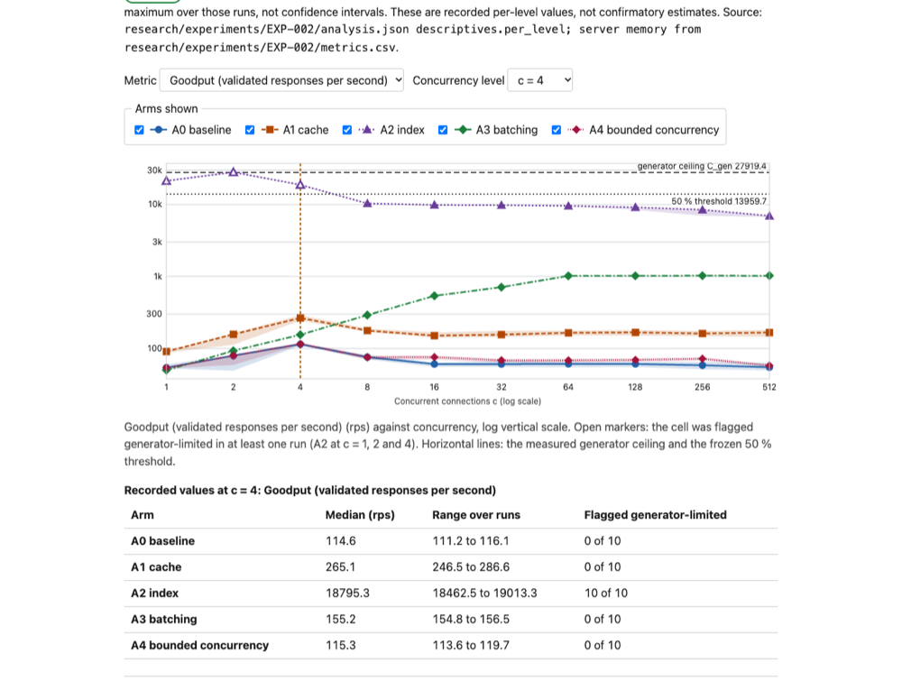

<!-- SPDX-License-Identifier: LicenseRef-SCALE-NC-Research-1.0 -->
# SCALE: how much work can one computer actually handle? (working title)

**Question.** What bottlenecks dominate local request throughput under different architecture choices?

**Status: M5 (interactive experience) done, 2026-11-25. Preprint draft, not peer-reviewed.** EXP-001 and EXP-002 ran under a protocol frozen by the owner on 2026-11-24 (`research/freeze.json`); EXP-003 and EXP-004 did not run. The manuscript is `research/paper/manuscript.md`. All measurements come from one laptop, one synthetic workload and one server on localhost; no result transfers to production traffic or to other hardware.

## Key results (EXP-002, confirmatory, 10 paired blocks)

Ratio R of each arm's peak goodput to the full-scan baseline, with the Bonferroni 98.75 % interval:

| Arm | R | 98.75 % interval | Verdict under the frozen rule |
|---|---|---|---|
| A1 cache | 2.337 | 2.254 to 2.435 | H0 rejected, R > 1 |
| A2 index | not estimated | | Excluded: peak generator-limited in every block (pending owner decision, below) |
| A3 batching | 9.005 | 8.921 to 9.093 | H0 rejected, R > 1 |
| A4 bounded concurrency | 1.015 | 1.000 to 1.030 | No meaningful effect (inside [0.95, 1.05]) |

Which factor dominates is unresolved. Both winning effects are conditional on the full-scan baseline: batching wins by sharing one scan among a batch. The size of the batching advantage over the cache depends on the summary metric (exploratory: 3.85 under G*, 1.58 under a closed-loop latency bound). EXP-001 validated the load generator (SCALE/ab ratios 0.942, 1.034 and 1.015 at c = 1, 8 and 32; generator ceiling 27919.4 rps).

## Pending owner decisions

Each is shown as "pending owner decision" here and on the demo page, with the readings the manuscript reports; none is chosen.

1. **D-012 reading (A2 exclusion).** Frozen-rule reading as applied: A2 has no confirmatory estimate and dominance is unresolved. Exploratory alternatives reported beside it, not verdicts: unfiltered within-block ratio 246.8 (98.75 % interval 243.4 to 250.2); G* over the levels not flagged 90.8 (90.0 to 91.8).
2. **EXP-003 parameters.** Four parameters are unset by the frozen text; EXP-003 did not run.
3. **EXP-004.** Whether the optional experiment runs; it did not run.
4. **`results/raw/`.** Whether the raw run outputs are committed; they are pinned by digests in `research/publication/artifact_manifest.json`.

## Why it matters

Caching, database indexes, request batching and bounded concurrency are standard answers to "the server is slow". SCALE measures, on one machine and one controlled workload, how much each of them changes successful throughput when applied alone to a simple baseline, with paired replicates and uncertainty intervals. Two planned checks, an open-loop load model (EXP-003) and other workload parameters (EXP-004), did not run.

## What is implemented

- The `scale` Python package (`src/scale/`): synthetic dataset and request streams, the HTTP server with arms A0 to A4, closed-loop and open-loop load generator, metrics, runner, versioned result schema with run manifests, report generator and CLI. See `src/README.md`.
- A pytest suite (`tests/`, see `tests/README.md`); the latest real count is in `progress.md`.
- Experiment configs (`experiments/`). `scale run` accepts a confirmatory config only if its file and protocol hashes match the freeze record.
- The interactive page (`demo/`): published results with their intervals and labels, the pending owner decisions, and a resource and latency explorer of the recorded EXP-002 runs. It runs no benchmark and makes no request to any service.

## Design (frozen v1.0)

- One Python standard-library HTTP server with SQLite on `127.0.0.1`; synthetic, seeded data.
- Baseline A0 versus A1 cache, A2 index, A3 batching, A4 bounded concurrency (8 workers, queue 16), one factor at a time. Against the full-scan baseline the index is expected to win by design.
- Primary metric: peak goodput over a closed-loop concurrency sweep; latency p50/p95/p99, errors, CPU and memory as secondary metrics.
- Details: [`research/protocol.md`](research/protocol.md), [`research/feasibility.md`](research/feasibility.md).

## Experiments

| ID | Title | Status |
|---|---|---|
| EXP-001 | Load-generator and measurement validation | complete (confirmatory); H0 holds, gate passed |
| EXP-002 | One-factor-at-a-time comparison (primary) | complete (confirmatory), 50 of 50 cells; A2 excluded (pending owner decision) |
| EXP-003 | Open-loop SLO goodput (sensitivity) | not run; four parameters await an owner decision |
| EXP-004 | Workload sensitivity (optional) | not run; owner decision on whether it runs |

Registry: [`research/experiment_registry.csv`](research/experiment_registry.csv).

## Data

No external dataset. All data are synthetic and regenerated from recorded seeds ([`data/manifest.json`](data/manifest.json)).

## Scope and limitations

Localhost only, one laptop, one implementation. No claim about production traffic or other hardware. See [`research/limitations.md`](research/limitations.md).

## Quick start

    uv sync --locked                      # environment from uv.lock
    uv run scale test -q                  # test suite
    uv run scale smoke                    # exploratory smoke matrix (about 40 s)
    uv run scale report results/exploratory/<dir> [--pdf]

The full reproduction sequence (quiet machine required) is in section 10 of the manuscript.

## Demo quick start

    cd demo && npm ci && npm run build && npm run preview

The page reads `demo/public/data/results.json`, written by `.venv/bin/python -I scripts/export_demo_data.py` from committed results only; `tests/test_demo_export.py` checks that it matches a fresh export and that every number it shows is printed in the manuscript. The page works offline after the first load and collects nothing about visitors. Demo URL: [placeholder: demo URL, not published; publication requires the owner's approval].

## Licence

SCALE Source-Available Non-Commercial Research License v1.0 (`LicenseRef-SCALE-NC-Research-1.0`); see [`LICENSE`](LICENSE) and [`NOTICE.md`](NOTICE.md). This is a custom source-available licence, not an OSI-approved open-source licence. Third-party material keeps its own terms.

## Citation

See [`CITATION.cff`](CITATION.cff). This is an independent research project, not peer reviewed. Author line and affiliation: [placeholder: author line, to be confirmed by the owner]. Repository URL: [placeholder: repository URL, not published; publication requires the owner's approval]. Funding and competing interests: [placeholder: to be supplied by the owner].
