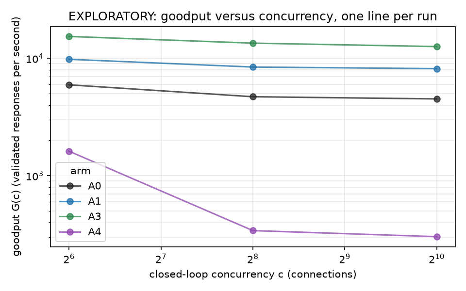

<!-- SPDX-License-Identifier: LicenseRef-SCALE-NC-Research-1.0 -->
# SCALE: EXPLORATORY run report

Generated by `scale report` from the validated result files in `results/exploratory/MECH-HICONC-20261124`. Labels present: exploratory.

**Exploratory.** These runs were made while the protocol is unfrozen. They measure the harness and planning quantities; they are not findings.

## Runs

| run id | block | position | arm | status | G* (rps) | c at peak | c_sat | runtime (s) | idle probe CPU % | load avg |
|---|---|---|---|---|---|---|---|---|---|---|
| MECH-HICONC-b00-A3-d57d01f8 | 0 | 0 | A3 | ok | 15376.0 | 64 | 64 | 11.6 | 31.0 | 3.99 2.41 1.96 |
| MECH-HICONC-b00-A1-d57d01f8 | 0 | 1 | A1 | ok | 9818.0 | 64 | 64 | 13.4 | 23.5 | 5.3 2.74 2.08 |
| MECH-HICONC-b00-A4-d57d01f8 | 0 | 2 | A4 | ok | 1616.0 | 64 | 64 | 13.3 | 9.9 | 5.44 2.89 2.14 |
| MECH-HICONC-b00-A0-d57d01f8 | 0 | 3 | A0 | ok | 5947.0 | 64 | 64 | 13.4 | 17.5 | 8.96 3.8 2.48 |

## Levels

| run id | c | rate (rps) | goodput (rps) | p50 (ms) | p95 (ms) | p99 (ms) | error rate | server CPU | generator CPU | gen-limited | ab (rps) |
|---|---|---|---|---|---|---|---|---|---|---|---|
| MECH-HICONC-b00-A0-d57d01f8 | 64 | n/a | 5947.0 | 8.73 | 26.31 | 50.66 | 0.0000 | 7.22 | 0.22 | no | n/a |
| MECH-HICONC-b00-A0-d57d01f8 | 256 | n/a | 4708.5 | 35.21 | 155.64 | 247.64 | 0.0000 | 7.23 | 0.22 | no | n/a |
| MECH-HICONC-b00-A0-d57d01f8 | 1024 | n/a | 4511.0 | 39.12 | 177.66 | 1227.94 | 0.0442 | 6.39 | 0.30 | no | n/a |
| MECH-HICONC-b00-A1-d57d01f8 | 64 | n/a | 9818.0 | 4.69 | 17.26 | 22.71 | 0.0000 | 6.90 | 0.33 | no | n/a |
| MECH-HICONC-b00-A1-d57d01f8 | 256 | n/a | 8432.5 | 17.84 | 66.80 | 99.82 | 0.0000 | 7.52 | 0.30 | no | n/a |
| MECH-HICONC-b00-A1-d57d01f8 | 1024 | n/a | 8172.0 | 18.63 | 69.40 | 103.85 | 0.0137 | 7.31 | 0.38 | no | n/a |
| MECH-HICONC-b00-A3-d57d01f8 | 64 | n/a | 15376.0 | 4.16 | 5.11 | 5.49 | 0.0000 | 1.75 | 1.57 | yes | n/a |
| MECH-HICONC-b00-A3-d57d01f8 | 256 | n/a | 13479.0 | 18.96 | 23.08 | 24.93 | 0.0000 | 1.62 | 1.31 | yes | n/a |
| MECH-HICONC-b00-A3-d57d01f8 | 1024 | n/a | 12606.0 | 83.35 | 88.50 | 91.86 | 0.0000 | 1.65 | 1.31 | yes | n/a |
| MECH-HICONC-b00-A4-d57d01f8 | 64 | n/a | 1616.0 | 7.31 | 66.40 | 118.83 | 0.9289 | 1.95 | 0.50 | no | n/a |
| MECH-HICONC-b00-A4-d57d01f8 | 256 | n/a | 340.0 | 34.41 | 288.39 | 623.67 | 0.9864 | 1.54 | 0.55 | no | n/a |
| MECH-HICONC-b00-A4-d57d01f8 | 1024 | n/a | 302.0 | 37.14 | 364.09 | 664.38 | 0.9870 | 1.55 | 0.79 | no | n/a |

## Within-block ratios to A0 (planning input for the sample size)

| arm | blocks | geometric mean R | SD of log R | 95 % half-width at n=10 | at n=20 | bootstrap 95 % (R) |
|---|---|---|---|---|---|---|
| A1 | 1 | 1.651 | n/a | n/a | n/a | n/a |
| A3 | 1 | 2.586 | n/a | n/a | n/a | n/a |
| A4 | 1 | 0.272 | n/a | n/a | n/a | n/a |

With very few blocks the SD estimate is itself very uncertain; it is a planning value.

## Projected runtime of the planned full matrix

Measured worst per-run overhead (database build, server start, generator start, teardown): 3.5 s. With 7 levels of 5.0 s warmup plus 15.0 s measurement, one run takes about 146 s and 50 runs about 2.02 h. Planning estimate.

## Degenerate cases and flags

- MECH-HICONC-b00-A0-d57d01f8: peak at the lowest swept concurrency c=64; goodput falls as concurrency rises
- MECH-HICONC-b00-A0-d57d01f8 c=1024: error rate 0.0442 {'200': 9022} transport=417
- MECH-HICONC-b00-A1-d57d01f8: peak at the lowest swept concurrency c=64; goodput falls as concurrency rises
- MECH-HICONC-b00-A1-d57d01f8 c=1024: error rate 0.0137 {'200': 16344} transport=227
- MECH-HICONC-b00-A3-d57d01f8: peak at the lowest swept concurrency c=64; goodput falls as concurrency rises
- MECH-HICONC-b00-A3-d57d01f8 c=64: generator-limited (generator CPU 1.57 > 0.85 x 1 cores)
- MECH-HICONC-b00-A3-d57d01f8 c=256: generator-limited (generator CPU 1.31 > 0.85 x 1 cores)
- MECH-HICONC-b00-A3-d57d01f8 c=1024: generator-limited (generator CPU 1.31 > 0.85 x 1 cores)
- MECH-HICONC-b00-A4-d57d01f8: peak at the lowest swept concurrency c=64; goodput falls as concurrency rises
- MECH-HICONC-b00-A4-d57d01f8 c=64: error rate 0.9289 {'200': 3232, '503': 42222} transport=0
- MECH-HICONC-b00-A4-d57d01f8 c=256: error rate 0.9864 {'200': 680, '503': 49371} transport=0
- MECH-HICONC-b00-A4-d57d01f8 c=1024: error rate 0.9870 {'200': 604, '503': 45615} transport=188

## Figure

