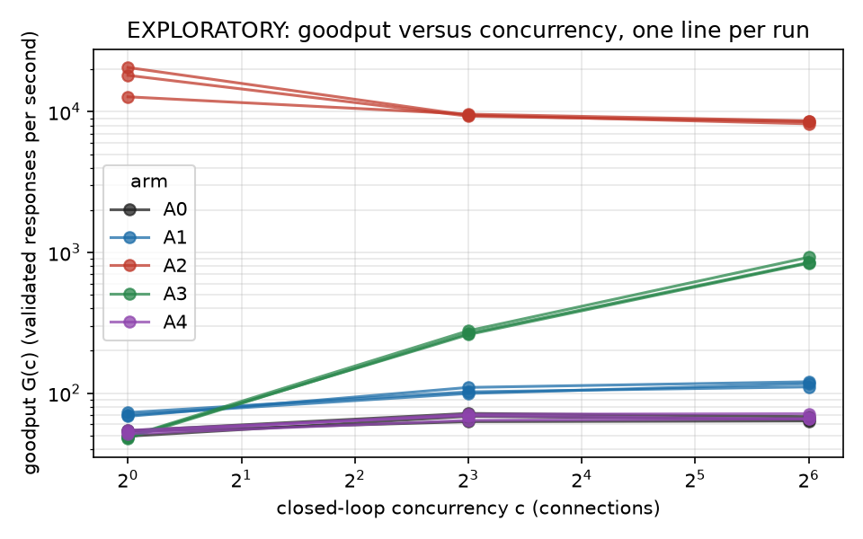

<!-- SPDX-License-Identifier: LicenseRef-SCALE-NC-Research-1.0 -->
# SCALE: EXPLORATORY run report

Generated by `scale report` from the validated result files in `results/exploratory/PILOT-20261124/`. Labels present: exploratory.

**Exploratory.** These runs were made while the protocol is unfrozen. They measure the harness and planning quantities; they are not findings.

## Runs

| run id | block | position | arm | status | G* (rps) | c at peak | c_sat | runtime (s) | idle probe CPU % | load avg |
|---|---|---|---|---|---|---|---|---|---|---|
| PILOT-b00-A2-4aea0083 | 0 | 0 | A2 | ok | 12773.3 | 1 | 1 | 19.0 | 87.0 | 22.32 36.14 21.62 |
| PILOT-b00-A0-4aea0083 | 0 | 1 | A0 | ok | 68.3 | 8 | 8 | 19.6 | 61.0 | 28.93 36.57 22.09 |
| PILOT-b00-A4-4aea0083 | 0 | 2 | A4 | ok | 71.3 | 64 | 8 | 19.9 | 95.2 | 28.29 35.86 22.17 |
| PILOT-b00-A3-4aea0083 | 0 | 3 | A3 | ok | 839.0 | 64 | 64 | 19.0 | 79.1 | 22.42 34.04 21.84 |
| PILOT-b00-A1-4aea0083 | 0 | 4 | A1 | ok | 120.3 | 64 | 64 | 19.5 | 52.8 | 25.93 33.96 22.08 |
| PILOT-b01-A3-4aea0083 | 1 | 0 | A3 | ok | 848.0 | 64 | 64 | 18.9 | 83.5 | 21.17 32.35 21.78 |
| PILOT-b01-A0-4aea0083 | 1 | 1 | A0 | ok | 63.3 | 64 | 8 | 19.6 | 58.0 | 22.65 31.93 21.88 |
| PILOT-b01-A2-4aea0083 | 1 | 2 | A2 | ok | 18154.3 | 1 | 1 | 18.9 | 69.6 | 20.19 30.93 21.69 |
| PILOT-b01-A1-4aea0083 | 1 | 3 | A1 | ok | 116.7 | 64 | 64 | 19.9 | 46.0 | 22.82 30.72 21.82 |
| PILOT-b01-A4-4aea0083 | 1 | 4 | A4 | ok | 65.7 | 64 | 8 | 19.9 | 74.4 | 19.8 29.49 21.59 |
| PILOT-b02-A2-4aea0083 | 2 | 0 | A2 | ok | 20642.7 | 1 | 1 | 18.9 | 27.0 | 16.32 28.05 21.25 |
| PILOT-b02-A0-4aea0083 | 2 | 1 | A0 | ok | 71.7 | 8 | 8 | 19.4 | 48.2 | 20.14 28.03 21.4 |
| PILOT-b02-A3-4aea0083 | 2 | 2 | A3 | ok | 923.7 | 64 | 64 | 18.9 | 43.1 | 16.1 26.59 21.03 |
| PILOT-b02-A4-4aea0083 | 2 | 3 | A4 | ok | 69.0 | 8 | 8 | 19.9 | 30.6 | 16.33 25.95 20.93 |
| PILOT-b02-A1-4aea0083 | 2 | 4 | A1 | ok | 110.7 | 64 | 64 | 19.7 | 33.7 | 20.41 26.21 21.14 |

## Levels

| run id | c | rate (rps) | goodput (rps) | p50 (ms) | p95 (ms) | p99 (ms) | error rate | server CPU | generator CPU | gen-limited | ab (rps) |
|---|---|---|---|---|---|---|---|---|---|---|---|
| PILOT-b00-A0-4aea0083 | 1 | n/a | 49.3 | 19.86 | 23.55 | 30.41 | 0.0000 | 0.96 | 0.01 | no | n/a |
| PILOT-b00-A0-4aea0083 | 8 | n/a | 68.3 | 116.56 | 154.93 | 177.74 | 0.0000 | 5.48 | 0.01 | no | n/a |
| PILOT-b00-A0-4aea0083 | 64 | n/a | 65.0 | 1004.35 | 1459.34 | 1677.27 | 0.0000 | 8.62 | 0.01 | no | n/a |
| PILOT-b00-A1-4aea0083 | 1 | n/a | 68.3 | 18.43 | 20.41 | 20.74 | 0.0000 | 0.98 | 0.01 | no | n/a |
| PILOT-b00-A1-4aea0083 | 8 | n/a | 109.7 | 94.60 | 137.86 | 155.40 | 0.0000 | 5.42 | 0.01 | no | n/a |
| PILOT-b00-A1-4aea0083 | 64 | n/a | 120.3 | 603.78 | 1236.85 | 1529.57 | 0.0000 | 8.57 | 0.01 | no | n/a |
| PILOT-b00-A2-4aea0083 | 1 | n/a | 12773.3 | 0.05 | 0.14 | 0.32 | 0.0000 | 0.58 | 0.25 | no | n/a |
| PILOT-b00-A2-4aea0083 | 8 | n/a | 9619.7 | 0.71 | 1.71 | 2.60 | 0.0000 | 2.01 | 0.30 | no | n/a |
| PILOT-b00-A2-4aea0083 | 64 | n/a | 8621.3 | 6.77 | 14.79 | 20.51 | 0.0000 | 2.55 | 0.27 | no | n/a |
| PILOT-b00-A3-4aea0083 | 1 | n/a | 48.7 | 20.79 | 21.87 | 22.43 | 0.0000 | 0.92 | 0.00 | no | n/a |
| PILOT-b00-A3-4aea0083 | 8 | n/a | 260.3 | 28.39 | 42.62 | 46.62 | 0.0000 | 1.16 | 0.03 | no | n/a |
| PILOT-b00-A3-4aea0083 | 64 | n/a | 839.0 | 76.68 | 91.87 | 123.96 | 0.0000 | 1.63 | 0.08 | no | n/a |
| PILOT-b00-A4-4aea0083 | 1 | n/a | 52.7 | 18.81 | 20.57 | 21.09 | 0.0000 | 0.99 | 0.00 | no | n/a |
| PILOT-b00-A4-4aea0083 | 8 | n/a | 70.7 | 111.69 | 139.16 | 157.87 | 0.0000 | 6.04 | 0.01 | no | n/a |
| PILOT-b00-A4-4aea0083 | 64 | n/a | 71.3 | 900.40 | 1690.82 | 1763.52 | 0.0000 | 6.11 | 0.01 | no | n/a |
| PILOT-b01-A0-4aea0083 | 1 | n/a | 53.3 | 18.41 | 19.81 | 25.79 | 0.0000 | 0.98 | 0.00 | no | n/a |
| PILOT-b01-A0-4aea0083 | 8 | n/a | 62.7 | 127.88 | 141.81 | 149.76 | 0.0000 | 7.06 | 0.01 | no | n/a |
| PILOT-b01-A0-4aea0083 | 64 | n/a | 63.3 | 1035.63 | 1508.60 | 1657.76 | 0.0000 | 8.69 | 0.01 | no | n/a |
| PILOT-b01-A1-4aea0083 | 1 | n/a | 70.0 | 18.75 | 20.98 | 22.29 | 0.0000 | 0.98 | 0.01 | no | n/a |
| PILOT-b01-A1-4aea0083 | 8 | n/a | 99.3 | 111.07 | 139.31 | 147.33 | 0.0000 | 6.57 | 0.01 | no | n/a |
| PILOT-b01-A1-4aea0083 | 64 | n/a | 116.7 | 646.63 | 1236.47 | 1534.58 | 0.0000 | 8.58 | 0.01 | no | n/a |
| PILOT-b01-A2-4aea0083 | 1 | n/a | 18154.3 | 0.05 | 0.07 | 0.15 | 0.0000 | 0.64 | 0.29 | no | n/a |
| PILOT-b01-A2-4aea0083 | 8 | n/a | 9311.3 | 0.81 | 1.49 | 1.91 | 0.0000 | 2.69 | 0.27 | no | n/a |
| PILOT-b01-A2-4aea0083 | 64 | n/a | 8513.0 | 7.02 | 14.07 | 17.86 | 0.0000 | 2.75 | 0.26 | no | n/a |
| PILOT-b01-A3-4aea0083 | 1 | n/a | 47.7 | 21.07 | 21.81 | 22.43 | 0.0000 | 0.92 | 0.00 | no | n/a |
| PILOT-b01-A3-4aea0083 | 8 | n/a | 265.7 | 28.24 | 41.12 | 54.27 | 0.0000 | 1.13 | 0.03 | no | n/a |
| PILOT-b01-A3-4aea0083 | 64 | n/a | 848.0 | 75.50 | 98.03 | 102.12 | 0.0000 | 1.60 | 0.07 | no | n/a |
| PILOT-b01-A4-4aea0083 | 1 | n/a | 51.3 | 19.50 | 20.37 | 22.54 | 0.0000 | 0.99 | 0.00 | no | n/a |
| PILOT-b01-A4-4aea0083 | 8 | n/a | 64.0 | 125.54 | 139.91 | 148.41 | 0.0000 | 7.03 | 0.01 | no | n/a |
| PILOT-b01-A4-4aea0083 | 64 | n/a | 65.7 | 981.42 | 1039.87 | 1899.19 | 0.0000 | 7.00 | 0.01 | no | n/a |
| PILOT-b02-A0-4aea0083 | 1 | n/a | 54.0 | 18.39 | 19.98 | 22.42 | 0.0000 | 0.99 | 0.00 | no | n/a |
| PILOT-b02-A0-4aea0083 | 8 | n/a | 71.7 | 112.68 | 122.17 | 127.05 | 0.0000 | 7.33 | 0.01 | no | n/a |
| PILOT-b02-A0-4aea0083 | 64 | n/a | 68.0 | 941.54 | 1154.69 | 1259.77 | 0.0000 | 9.11 | 0.01 | no | n/a |
| PILOT-b02-A1-4aea0083 | 1 | n/a | 72.7 | 18.43 | 20.16 | 20.71 | 0.0000 | 0.98 | 0.00 | no | n/a |
| PILOT-b02-A1-4aea0083 | 8 | n/a | 102.0 | 110.60 | 146.63 | 155.97 | 0.0000 | 6.76 | 0.01 | no | n/a |
| PILOT-b02-A1-4aea0083 | 64 | n/a | 110.7 | 685.29 | 1427.34 | 1848.03 | 0.0000 | 8.97 | 0.01 | no | n/a |
| PILOT-b02-A2-4aea0083 | 1 | n/a | 20642.7 | 0.04 | 0.05 | 0.09 | 0.0000 | 0.67 | 0.30 | no | n/a |
| PILOT-b02-A2-4aea0083 | 8 | n/a | 9456.7 | 0.80 | 1.42 | 1.83 | 0.0000 | 2.76 | 0.27 | no | n/a |
| PILOT-b02-A2-4aea0083 | 64 | n/a | 8214.3 | 7.34 | 14.06 | 18.46 | 0.0000 | 2.81 | 0.26 | no | n/a |
| PILOT-b02-A3-4aea0083 | 1 | n/a | 49.0 | 20.14 | 21.80 | 25.54 | 0.0000 | 0.91 | 0.00 | no | n/a |
| PILOT-b02-A3-4aea0083 | 8 | n/a | 277.3 | 28.15 | 36.52 | 37.55 | 0.0000 | 1.14 | 0.02 | no | n/a |
| PILOT-b02-A3-4aea0083 | 64 | n/a | 923.7 | 68.64 | 85.79 | 96.08 | 0.0000 | 1.53 | 0.10 | no | n/a |
| PILOT-b02-A4-4aea0083 | 1 | n/a | 54.3 | 18.09 | 19.47 | 26.27 | 0.0000 | 0.98 | 0.00 | no | n/a |
| PILOT-b02-A4-4aea0083 | 8 | n/a | 69.0 | 115.22 | 127.77 | 132.58 | 0.0000 | 7.42 | 0.01 | no | n/a |
| PILOT-b02-A4-4aea0083 | 64 | n/a | 65.3 | 977.62 | 1797.45 | 1845.09 | 0.0000 | 6.75 | 0.01 | no | n/a |

## Within-block ratios to A0 (planning input for the sample size)

| arm | blocks | geometric mean R | SD of log R | 95 % half-width at n=10 | at n=20 | bootstrap 95 % (R) |
|---|---|---|---|---|---|---|
| A1 | 3 | 1.711 | 0.0917 | 0.0656 | 0.0429 | [1.544, 1.842] |
| A2 | 3 | 248.975 | 0.2482 | 0.1776 | 0.1162 | [186.927, 288.037] |
| A3 | 3 | 12.844 | 0.0434 | 0.0311 | 0.0203 | [12.278, 13.389] |
| A4 | 3 | 1.014 | 0.0449 | 0.0321 | 0.0210 | [0.963, 1.044] |

With very few blocks the SD estimate is itself very uncertain; it is a planning value.

## Projected runtime of the planned full matrix

Measured worst per-run overhead (database build, server start, generator start, teardown): 4.0 s. With 7 levels of 5.0 s warmup plus 15.0 s measurement, one run takes about 146 s and 50 runs about 2.03 h. Planning estimate.

## Degenerate cases and flags

- PILOT-b00-A1-4aea0083: peak at the highest swept concurrency c=64; saturation not reached, G* is truncated by the sweep
- PILOT-b00-A1-4aea0083: A1 cache hit ratio 0.35 (514 hits, 951 misses); the cache is mostly cold
- PILOT-b00-A2-4aea0083: peak at the lowest swept concurrency c=1; goodput falls as concurrency rises
- PILOT-b00-A3-4aea0083: peak at the highest swept concurrency c=64; saturation not reached, G* is truncated by the sweep
- PILOT-b00-A4-4aea0083: peak at the highest swept concurrency c=64; saturation not reached, G* is truncated by the sweep
- PILOT-b00-A4-4aea0083: A4 admission limit never triggered (no HTTP 503)
- PILOT-b01-A0-4aea0083: peak at the highest swept concurrency c=64; saturation not reached, G* is truncated by the sweep
- PILOT-b01-A1-4aea0083: peak at the highest swept concurrency c=64; saturation not reached, G* is truncated by the sweep
- PILOT-b01-A1-4aea0083: A1 cache hit ratio 0.34 (479 hits, 928 misses); the cache is mostly cold
- PILOT-b01-A2-4aea0083: peak at the lowest swept concurrency c=1; goodput falls as concurrency rises
- PILOT-b01-A3-4aea0083: peak at the highest swept concurrency c=64; saturation not reached, G* is truncated by the sweep
- PILOT-b01-A4-4aea0083: peak at the highest swept concurrency c=64; saturation not reached, G* is truncated by the sweep
- PILOT-b01-A4-4aea0083: A4 admission limit never triggered (no HTTP 503)
- PILOT-b02-A1-4aea0083: peak at the highest swept concurrency c=64; saturation not reached, G* is truncated by the sweep
- PILOT-b02-A1-4aea0083: A1 cache hit ratio 0.36 (497 hits, 886 misses); the cache is mostly cold
- PILOT-b02-A2-4aea0083: peak at the lowest swept concurrency c=1; goodput falls as concurrency rises
- PILOT-b02-A3-4aea0083: peak at the highest swept concurrency c=64; saturation not reached, G* is truncated by the sweep
- PILOT-b02-A4-4aea0083: A4 admission limit never triggered (no HTTP 503)

## Figure

