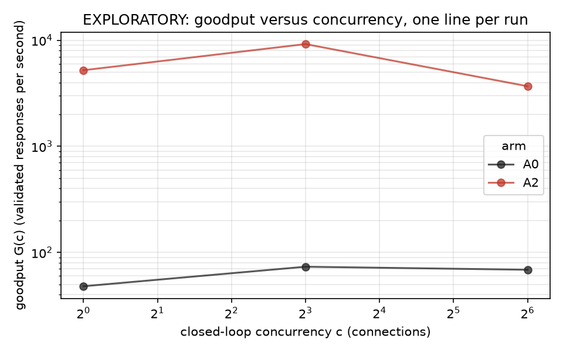

<!-- SPDX-License-Identifier: LicenseRef-SCALE-NC-Research-1.0 -->
# SCALE: EXPLORATORY run report

Generated by `scale report` from the validated result files in `results/exploratory/SMOKE-20261124/`. Labels present: exploratory.

**Exploratory.** These runs were made while the protocol is unfrozen. They measure the harness and planning quantities; they are not findings.

## Runs

| run id | block | position | arm | status | G* (rps) | c at peak | c_sat | runtime (s) | idle probe CPU % | load avg |
|---|---|---|---|---|---|---|---|---|---|---|
| SMOKE-b00-A2-431d6ecd | 0 | 0 | A2 | ok | 9192.3 | 8 | 8 | 20.3 | 100.0 | 73.8 46.0 22.37 |
| SMOKE-b00-A0-431d6ecd | 0 | 1 | A0 | ok | 73.3 | 8 | 8 | 19.6 | 92.1 | 65.75 45.85 22.86 |

## Levels

| run id | c | rate (rps) | goodput (rps) | p50 (ms) | p95 (ms) | p99 (ms) | error rate | server CPU | generator CPU | gen-limited | ab (rps) |
|---|---|---|---|---|---|---|---|---|---|---|---|
| SMOKE-b00-A0-431d6ecd | 1 | n/a | 48.0 | 20.20 | 25.00 | 27.20 | 0.0000 | 0.95 | 0.01 | no | n/a |
| SMOKE-b00-A0-431d6ecd | 8 | n/a | 73.3 | 102.11 | 188.58 | 226.07 | 0.0000 | 4.60 | 0.01 | no | n/a |
| SMOKE-b00-A0-431d6ecd | 64 | n/a | 68.7 | 964.49 | 1358.79 | 1765.50 | 0.0000 | 8.04 | 0.01 | no | n/a |
| SMOKE-b00-A2-431d6ecd | 1 | n/a | 5214.3 | 0.08 | 0.47 | 1.57 | 0.0000 | 0.45 | 0.20 | no | n/a |
| SMOKE-b00-A2-431d6ecd | 8 | n/a | 9192.3 | 0.50 | 2.74 | 5.50 | 0.0000 | 0.95 | 0.30 | no | n/a |
| SMOKE-b00-A2-431d6ecd | 64 | n/a | 3682.3 | 15.10 | 39.63 | 56.15 | 0.0000 | 1.45 | 0.25 | no | n/a |

## Within-block ratios to A0 (planning input for the sample size)

| arm | blocks | geometric mean R | SD of log R | 95 % half-width at n=10 | at n=20 | bootstrap 95 % (R) |
|---|---|---|---|---|---|---|
| A2 | 1 | 125.350 | n/a | n/a | n/a | n/a |

With very few blocks the SD estimate is itself very uncertain; it is a planning value.

## Projected runtime of the planned full matrix

Measured worst per-run overhead (database build, server start, generator start, teardown): 4.4 s. With 7 levels of 5.0 s warmup plus 15.0 s measurement, one run takes about 147 s and 50 runs about 2.03 h. Planning estimate.

## Degenerate cases and flags

- none

## Figure

