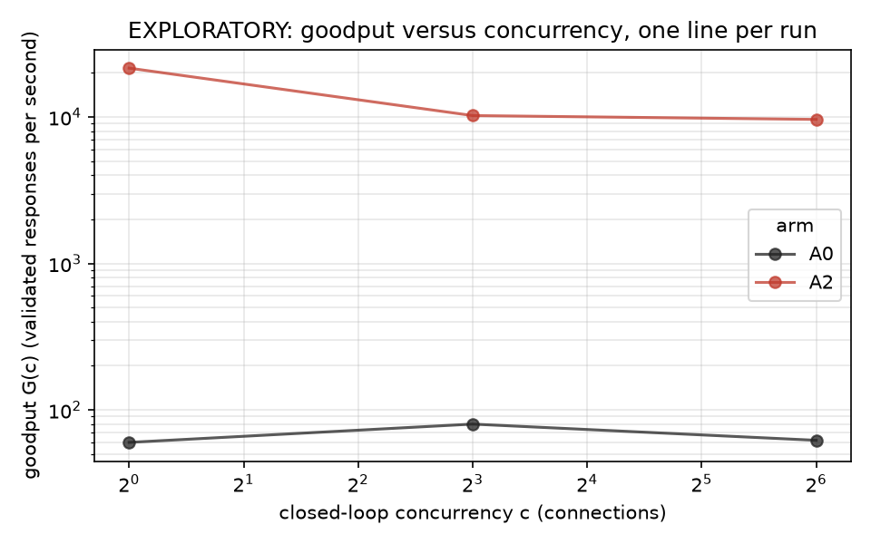

<!-- SPDX-License-Identifier: LicenseRef-SCALE-NC-Research-1.0 -->
# SCALE: EXPLORATORY run report

Generated by `scale report` from the validated result files in `results/exploratory/SMOKE-M3-20261125`. Labels present: exploratory.

**Exploratory.** These runs were made while the protocol is unfrozen. They measure the harness and planning quantities; they are not findings.

## Runs

| run id | block | position | arm | status | G* (rps) | c at peak | c_sat | runtime (s) | idle probe CPU % | load avg |
|---|---|---|---|---|---|---|---|---|---|---|
| SMOKE-b00-A2-431d6ecd | 0 | 0 | A2 | ok | 21564.3 | 1 | 1 | 18.9 | 19.8 | 3.73 4.06 3.44 |
| SMOKE-b00-A0-431d6ecd | 0 | 1 | A0 | ok | 80.0 | 8 | 8 | 19.4 | 19.5 | 13.88 6.22 4.22 |

## Levels

| run id | c | rate (rps) | goodput (rps) | p50 (ms) | p95 (ms) | p99 (ms) | error rate | server CPU | generator CPU | gen-limited | ab (rps) |
|---|---|---|---|---|---|---|---|---|---|---|---|
| SMOKE-b00-A0-431d6ecd | 1 | n/a | 60.0 | 16.62 | 16.87 | 17.99 | 0.0000 | 0.99 | 0.00 | no | n/a |
| SMOKE-b00-A0-431d6ecd | 8 | n/a | 80.0 | 100.79 | 103.07 | 106.67 | 0.0000 | 7.96 | 0.00 | no | n/a |
| SMOKE-b00-A0-431d6ecd | 64 | n/a | 62.0 | 989.82 | 1382.01 | 1453.21 | 0.0000 | 9.80 | 0.01 | no | n/a |
| SMOKE-b00-A2-431d6ecd | 1 | n/a | 21564.3 | 0.04 | 0.05 | 0.08 | 0.0000 | 0.67 | 0.29 | no | n/a |
| SMOKE-b00-A2-431d6ecd | 8 | n/a | 10227.7 | 0.74 | 1.28 | 1.66 | 0.0000 | 2.80 | 0.27 | no | n/a |
| SMOKE-b00-A2-431d6ecd | 64 | n/a | 9627.3 | 6.38 | 11.39 | 14.30 | 0.0000 | 2.93 | 0.26 | no | n/a |

## Within-block ratios to A0 (planning input for the sample size)

| arm | blocks | geometric mean R | SD of log R | 95 % half-width at n=10 | at n=20 | bootstrap 95 % (R) |
|---|---|---|---|---|---|---|
| A2 | 1 | 269.554 | n/a | n/a | n/a | n/a |

With very few blocks the SD estimate is itself very uncertain; it is a planning value.

## Projected runtime of the planned full matrix

Measured worst per-run overhead (database build, server start, generator start, teardown): 3.5 s. With 7 levels of 5.0 s warmup plus 15.0 s measurement, one run takes about 146 s and 50 runs about 2.02 h. Planning estimate.

## Degenerate cases and flags

- SMOKE-b00-A2-431d6ecd: peak at the lowest swept concurrency c=1; goodput falls as concurrency rises

## Figure

