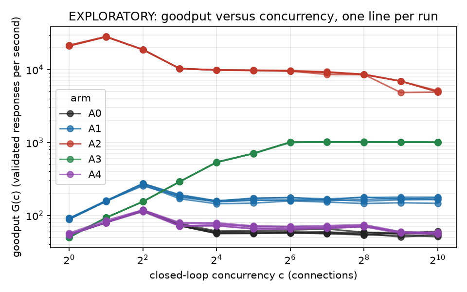

<!-- SPDX-License-Identifier: LicenseRef-SCALE-NC-Research-1.0 -->
# SCALE: EXPLORATORY run report

Generated by `scale report` from the validated result files in `results/raw/PILOT-QUIET/PILOT-QUIET-M3`. Labels present: exploratory.

**Exploratory.** These runs were made while the protocol is unfrozen. They measure the harness and planning quantities; they are not findings.

## Runs

| run id | block | position | arm | status | G* (rps) | c at peak | c_sat | runtime (s) | idle probe CPU % | load avg |
|---|---|---|---|---|---|---|---|---|---|---|
| PILOT-QUIET-b00-A0-721f78b8 | 0 | 0 | A0 | ok | 114.1 | 4 | 4 | 246.4 | 4.4 | 146.47 55.81 24.13 |
| PILOT-QUIET-b00-A1-721f78b8 | 0 | 1 | A1 | ok | 254.7 | 4 | 4 | 239.7 | 8.2 | 64.58 48.77 27.74 |
| PILOT-QUIET-b00-A3-721f78b8 | 0 | 2 | A3 | ok | 1016.2 | 128 | 64 | 228.3 | 6.3 | 3.81 24.24 21.85 |
| PILOT-QUIET-b00-A4-721f78b8 | 0 | 3 | A4 | ok | 112.7 | 4 | 4 | 230.4 | 2.0 | 9.69 16.0 18.7 |
| PILOT-QUIET-b00-A2-721f78b8 | 0 | 4 | A2 | ok | 28241.2 | 2 | 2 | 229.3 | 3.9 | 6.91 10.35 15.5 |
| PILOT-QUIET-b01-A3-721f78b8 | 1 | 0 | A3 | ok | 1021.2 | 128 | 64 | 228.4 | 2.5 | 2.9 6.23 12.47 |
| PILOT-QUIET-b01-A2-721f78b8 | 1 | 1 | A2 | ok | 28109.9 | 2 | 2 | 229.3 | 5.8 | 6.56 5.8 10.75 |
| PILOT-QUIET-b01-A1-721f78b8 | 1 | 2 | A1 | ok | 263.9 | 4 | 4 | 239.0 | 2.2 | 67.41 28.41 18.43 |
| PILOT-QUIET-b01-A4-721f78b8 | 1 | 3 | A4 | ok | 117.6 | 4 | 4 | 230.5 | 5.1 | 10.45 17.59 15.94 |
| PILOT-QUIET-b01-A0-721f78b8 | 1 | 4 | A0 | ok | 117.6 | 4 | 4 | 246.8 | 2.7 | 128.61 56.47 31.35 |
| PILOT-QUIET-b02-A3-721f78b8 | 2 | 0 | A3 | ok | 1016.3 | 256 | 64 | 228.3 | 5.6 | 5.03 27.22 24.38 |
| PILOT-QUIET-b02-A1-721f78b8 | 2 | 1 | A1 | ok | 273.5 | 4 | 4 | 239.0 | 2.9 | 63.02 37.25 28.47 |
| PILOT-QUIET-b02-A4-721f78b8 | 2 | 2 | A4 | ok | 117.7 | 4 | 4 | 230.5 | 2.8 | 9.24 21.27 23.45 |
| PILOT-QUIET-b02-A0-721f78b8 | 2 | 3 | A0 | ok | 117.9 | 4 | 4 | 248.1 | 3.1 | 124.1 55.0 35.7 |
| PILOT-QUIET-b02-A2-721f78b8 | 2 | 4 | A2 | ok | 28322.5 | 2 | 2 | 231.1 | 5.8 | 12.41 29.64 28.96 |
| PILOT-QUIET-b03-A3-721f78b8 | 3 | 0 | A3 | ok | 1020.9 | 128 | 64 | 228.2 | 3.1 | 3.53 15.12 22.68 |
| PILOT-QUIET-b03-A2-721f78b8 | 3 | 1 | A2 | ok | 28403.9 | 2 | 2 | 229.3 | 6.5 | 29.52 17.89 21.6 |
| PILOT-QUIET-b03-A0-721f78b8 | 3 | 2 | A0 | ok | 117.6 | 4 | 4 | 246.1 | 4.8 | 107.13 50.37 33.26 |
| PILOT-QUIET-b03-A4-721f78b8 | 3 | 3 | A4 | ok | 118.9 | 4 | 4 | 229.4 | 3.5 | 13.17 28.91 27.75 |
| PILOT-QUIET-b03-A1-721f78b8 | 3 | 4 | A1 | ok | 272.8 | 4 | 4 | 239.1 | 2.4 | 64.76 38.86 31.38 |
| PILOT-QUIET-b04-A0-721f78b8 | 4 | 0 | A0 | ok | 117.5 | 4 | 4 | 245.6 | 2.5 | 138.73 69.23 44.25 |
| PILOT-QUIET-b04-A2-721f78b8 | 4 | 1 | A2 | ok | 28424.7 | 2 | 2 | 229.3 | 5.8 | 8.69 34.69 34.88 |
| PILOT-QUIET-b04-A3-721f78b8 | 4 | 2 | A3 | ok | 1023.7 | 256 | 64 | 228.2 | 6.4 | 2.86 17.34 27.16 |
| PILOT-QUIET-b04-A4-721f78b8 | 4 | 3 | A4 | ok | 119.0 | 4 | 4 | 230.2 | 13.0 | 9.19 12.83 22.77 |
| PILOT-QUIET-b04-A1-721f78b8 | 4 | 4 | A1 | ok | 273.9 | 4 | 4 | 238.8 | 2.7 | 69.43 32.19 27.81 |

## Levels

| run id | c | rate (rps) | goodput (rps) | p50 (ms) | p95 (ms) | p99 (ms) | error rate | server CPU | generator CPU | gen-limited | ab (rps) |
|---|---|---|---|---|---|---|---|---|---|---|---|
| PILOT-QUIET-b00-A0-721f78b8 | 1 | n/a | 54.1 | 18.61 | 19.35 | 20.14 | 0.0000 | 0.99 | 0.00 | no | n/a |
| PILOT-QUIET-b00-A0-721f78b8 | 2 | n/a | 80.3 | 24.94 | 26.60 | 28.96 | 0.0000 | 1.91 | 0.00 | no | n/a |
| PILOT-QUIET-b00-A0-721f78b8 | 4 | n/a | 114.1 | 34.90 | 41.26 | 44.37 | 0.0000 | 3.82 | 0.01 | no | n/a |
| PILOT-QUIET-b00-A0-721f78b8 | 8 | n/a | 72.8 | 110.60 | 113.21 | 115.49 | 0.0000 | 7.85 | 0.00 | no | n/a |
| PILOT-QUIET-b00-A0-721f78b8 | 16 | n/a | 57.9 | 276.04 | 306.33 | 320.70 | 0.0000 | 9.67 | 0.01 | no | n/a |
| PILOT-QUIET-b00-A0-721f78b8 | 32 | n/a | 57.1 | 551.83 | 665.71 | 756.43 | 0.0000 | 9.80 | 0.01 | no | n/a |
| PILOT-QUIET-b00-A0-721f78b8 | 64 | n/a | 58.0 | 1039.51 | 1408.05 | 1640.05 | 0.0000 | 9.79 | 0.01 | no | n/a |
| PILOT-QUIET-b00-A0-721f78b8 | 128 | n/a | 59.5 | 2104.74 | 3053.86 | 3463.93 | 0.0034 | 9.79 | 0.01 | no | n/a |
| PILOT-QUIET-b00-A0-721f78b8 | 256 | n/a | 53.9 | 3155.27 | 5929.06 | 8153.21 | 0.0890 | 9.83 | 0.01 | no | n/a |
| PILOT-QUIET-b00-A0-721f78b8 | 512 | n/a | 58.4 | 5401.63 | 7582.23 | 8707.78 | 0.2416 | 9.79 | 0.02 | no | n/a |
| PILOT-QUIET-b00-A0-721f78b8 | 1024 | n/a | 54.8 | 4041.80 | 6756.49 | 9726.13 | 0.4680 | 9.71 | 0.04 | no | n/a |
| PILOT-QUIET-b00-A1-721f78b8 | 1 | n/a | 91.5 | 16.93 | 18.96 | 19.57 | 0.0000 | 0.99 | 0.01 | no | n/a |
| PILOT-QUIET-b00-A1-721f78b8 | 2 | n/a | 157.3 | 22.52 | 25.59 | 29.91 | 0.0000 | 1.92 | 0.01 | no | n/a |
| PILOT-QUIET-b00-A1-721f78b8 | 4 | n/a | 254.7 | 0.23 | 39.26 | 43.18 | 0.0000 | 3.81 | 0.01 | no | n/a |
| PILOT-QUIET-b00-A1-721f78b8 | 8 | n/a | 182.8 | 0.19 | 110.56 | 112.37 | 0.0000 | 7.84 | 0.01 | no | n/a |
| PILOT-QUIET-b00-A1-721f78b8 | 16 | n/a | 153.1 | 2.56 | 280.65 | 357.16 | 0.0000 | 9.66 | 0.02 | no | n/a |
| PILOT-QUIET-b00-A1-721f78b8 | 32 | n/a | 160.7 | 9.14 | 494.74 | 634.95 | 0.0017 | 9.72 | 0.02 | no | n/a |
| PILOT-QUIET-b00-A1-721f78b8 | 64 | n/a | 162.7 | 126.37 | 1075.50 | 1504.90 | 0.0069 | 9.76 | 0.02 | no | n/a |
| PILOT-QUIET-b00-A1-721f78b8 | 128 | n/a | 165.3 | 469.61 | 2071.80 | 2682.96 | 0.0076 | 9.75 | 0.02 | no | n/a |
| PILOT-QUIET-b00-A1-721f78b8 | 256 | n/a | 156.6 | 1162.09 | 4420.68 | 5944.58 | 0.0134 | 9.81 | 0.02 | no | n/a |
| PILOT-QUIET-b00-A1-721f78b8 | 512 | n/a | 163.7 | 1573.85 | 8592.21 | 11444.17 | 0.0746 | 9.77 | 0.03 | no | n/a |
| PILOT-QUIET-b00-A1-721f78b8 | 1024 | n/a | 165.1 | 2181.20 | 7264.52 | 9654.80 | 0.2245 | 9.60 | 0.06 | no | n/a |
| PILOT-QUIET-b00-A2-721f78b8 | 1 | n/a | 21180.3 | 0.04 | 0.05 | 0.08 | 0.0000 | 0.66 | 0.31 | no | n/a |
| PILOT-QUIET-b00-A2-721f78b8 | 2 | n/a | 28241.2 | 0.07 | 0.08 | 0.11 | 0.0000 | 1.21 | 0.47 | no | n/a |
| PILOT-QUIET-b00-A2-721f78b8 | 4 | n/a | 18787.1 | 0.20 | 0.34 | 0.41 | 0.0000 | 1.94 | 0.48 | no | n/a |
| PILOT-QUIET-b00-A2-721f78b8 | 8 | n/a | 10346.9 | 0.74 | 1.27 | 1.64 | 0.0000 | 2.80 | 0.29 | no | n/a |
| PILOT-QUIET-b00-A2-721f78b8 | 16 | n/a | 9855.0 | 1.54 | 2.74 | 3.58 | 0.0000 | 2.87 | 0.27 | no | n/a |
| PILOT-QUIET-b00-A2-721f78b8 | 32 | n/a | 9705.5 | 3.12 | 5.71 | 7.38 | 0.0000 | 2.88 | 0.27 | no | n/a |
| PILOT-QUIET-b00-A2-721f78b8 | 64 | n/a | 9706.9 | 6.29 | 11.37 | 14.25 | 0.0000 | 2.93 | 0.26 | no | n/a |
| PILOT-QUIET-b00-A2-721f78b8 | 128 | n/a | 9352.2 | 13.14 | 23.59 | 29.48 | 0.0000 | 3.04 | 0.26 | no | n/a |
| PILOT-QUIET-b00-A2-721f78b8 | 256 | n/a | 8621.3 | 28.65 | 51.67 | 63.49 | 0.0000 | 3.17 | 0.24 | no | n/a |
| PILOT-QUIET-b00-A2-721f78b8 | 512 | n/a | 6950.9 | 68.47 | 129.42 | 163.46 | 0.0000 | 3.64 | 0.20 | no | n/a |
| PILOT-QUIET-b00-A2-721f78b8 | 1024 | n/a | 5140.9 | 84.68 | 283.00 | 419.42 | 0.0139 | 5.15 | 0.20 | no | n/a |
| PILOT-QUIET-b00-A3-721f78b8 | 1 | n/a | 50.3 | 20.04 | 20.46 | 21.29 | 0.0000 | 0.92 | 0.00 | no | n/a |
| PILOT-QUIET-b00-A3-721f78b8 | 2 | n/a | 92.9 | 21.57 | 23.68 | 25.93 | 0.0000 | 0.98 | 0.00 | no | n/a |
| PILOT-QUIET-b00-A3-721f78b8 | 4 | n/a | 154.9 | 25.75 | 28.44 | 29.84 | 0.0000 | 1.03 | 0.01 | no | n/a |
| PILOT-QUIET-b00-A3-721f78b8 | 8 | n/a | 291.3 | 27.31 | 31.02 | 34.97 | 0.0000 | 1.10 | 0.02 | no | n/a |
| PILOT-QUIET-b00-A3-721f78b8 | 16 | n/a | 535.4 | 29.33 | 33.97 | 53.67 | 0.0000 | 1.26 | 0.05 | no | n/a |
| PILOT-QUIET-b00-A3-721f78b8 | 32 | n/a | 705.2 | 52.11 | 63.11 | 67.56 | 0.0000 | 1.31 | 0.07 | no | n/a |
| PILOT-QUIET-b00-A3-721f78b8 | 64 | n/a | 1012.8 | 63.48 | 72.08 | 76.15 | 0.0000 | 1.53 | 0.10 | no | n/a |
| PILOT-QUIET-b00-A3-721f78b8 | 128 | n/a | 1016.2 | 127.60 | 137.01 | 143.31 | 0.0000 | 1.53 | 0.10 | no | n/a |
| PILOT-QUIET-b00-A3-721f78b8 | 256 | n/a | 1012.5 | 256.62 | 273.40 | 284.76 | 0.0000 | 1.54 | 0.10 | no | n/a |
| PILOT-QUIET-b00-A3-721f78b8 | 512 | n/a | 1012.1 | 515.44 | 542.75 | 549.08 | 0.0000 | 1.53 | 0.10 | no | n/a |
| PILOT-QUIET-b00-A3-721f78b8 | 1024 | n/a | 1004.2 | 1034.16 | 1078.79 | 1099.59 | 0.0000 | 1.55 | 0.11 | no | n/a |
| PILOT-QUIET-b00-A4-721f78b8 | 1 | n/a | 54.3 | 18.64 | 19.00 | 19.72 | 0.0000 | 0.99 | 0.00 | no | n/a |
| PILOT-QUIET-b00-A4-721f78b8 | 2 | n/a | 79.5 | 25.14 | 28.20 | 30.56 | 0.0000 | 1.92 | 0.00 | no | n/a |
| PILOT-QUIET-b00-A4-721f78b8 | 4 | n/a | 112.7 | 34.72 | 43.04 | 51.56 | 0.0000 | 3.83 | 0.01 | no | n/a |
| PILOT-QUIET-b00-A4-721f78b8 | 8 | n/a | 71.1 | 111.97 | 120.60 | 135.22 | 0.0000 | 7.78 | 0.00 | no | n/a |
| PILOT-QUIET-b00-A4-721f78b8 | 16 | n/a | 72.0 | 223.58 | 337.75 | 449.21 | 0.0000 | 7.89 | 0.01 | no | n/a |
| PILOT-QUIET-b00-A4-721f78b8 | 32 | n/a | 65.1 | 128.12 | 1351.86 | 2101.75 | 0.9940 | 8.47 | 0.38 | no | n/a |
| PILOT-QUIET-b00-A4-721f78b8 | 64 | n/a | 64.9 | 129.61 | 1382.84 | 2343.13 | 0.9951 | 8.35 | 0.46 | no | n/a |
| PILOT-QUIET-b00-A4-721f78b8 | 128 | n/a | 66.5 | 133.28 | 1423.56 | 2541.13 | 0.9958 | 7.90 | 0.52 | no | n/a |
| PILOT-QUIET-b00-A4-721f78b8 | 256 | n/a | 70.3 | 142.82 | 1309.90 | 2157.57 | 0.9962 | 6.90 | 0.61 | no | n/a |
| PILOT-QUIET-b00-A4-721f78b8 | 512 | n/a | 58.7 | 172.68 | 1724.31 | 3122.68 | 0.9965 | 5.49 | 0.61 | no | n/a |
| PILOT-QUIET-b00-A4-721f78b8 | 1024 | n/a | 56.6 | 182.01 | 1841.19 | 3369.02 | 0.9965 | 5.31 | 0.78 | no | n/a |
| PILOT-QUIET-b01-A0-721f78b8 | 1 | n/a | 54.1 | 18.60 | 18.93 | 19.65 | 0.0000 | 0.99 | 0.00 | no | n/a |
| PILOT-QUIET-b01-A0-721f78b8 | 2 | n/a | 79.6 | 25.26 | 26.54 | 29.23 | 0.0000 | 1.92 | 0.00 | no | n/a |
| PILOT-QUIET-b01-A0-721f78b8 | 4 | n/a | 117.6 | 33.07 | 39.40 | 41.95 | 0.0000 | 3.80 | 0.01 | no | n/a |
| PILOT-QUIET-b01-A0-721f78b8 | 8 | n/a | 72.3 | 110.96 | 113.42 | 117.07 | 0.0000 | 7.84 | 0.00 | no | n/a |
| PILOT-QUIET-b01-A0-721f78b8 | 16 | n/a | 56.3 | 283.17 | 310.99 | 323.23 | 0.0000 | 9.74 | 0.01 | no | n/a |
| PILOT-QUIET-b01-A0-721f78b8 | 32 | n/a | 56.5 | 551.49 | 688.16 | 800.66 | 0.0000 | 9.81 | 0.01 | no | n/a |
| PILOT-QUIET-b01-A0-721f78b8 | 64 | n/a | 57.5 | 1090.17 | 1482.52 | 1726.44 | 0.0000 | 9.79 | 0.01 | no | n/a |
| PILOT-QUIET-b01-A0-721f78b8 | 128 | n/a | 56.5 | 2148.25 | 2996.84 | 3285.37 | 0.0117 | 9.81 | 0.01 | no | n/a |
| PILOT-QUIET-b01-A0-721f78b8 | 256 | n/a | 56.1 | 3508.03 | 5528.87 | 6755.51 | 0.0738 | 9.84 | 0.01 | no | n/a |
| PILOT-QUIET-b01-A0-721f78b8 | 512 | n/a | 50.7 | 3285.12 | 8015.83 | 9782.55 | 0.4337 | 9.76 | 0.02 | no | n/a |
| PILOT-QUIET-b01-A0-721f78b8 | 1024 | n/a | 53.9 | 4615.51 | 6459.25 | 9130.11 | 0.3673 | 9.72 | 0.04 | no | n/a |
| PILOT-QUIET-b01-A1-721f78b8 | 1 | n/a | 88.8 | 18.19 | 18.89 | 19.59 | 0.0000 | 0.99 | 0.00 | no | n/a |
| PILOT-QUIET-b01-A1-721f78b8 | 2 | n/a | 155.1 | 22.71 | 25.63 | 26.60 | 0.0000 | 1.91 | 0.01 | no | n/a |
| PILOT-QUIET-b01-A1-721f78b8 | 4 | n/a | 263.9 | 0.24 | 38.30 | 42.20 | 0.0000 | 3.81 | 0.01 | no | n/a |
| PILOT-QUIET-b01-A1-721f78b8 | 8 | n/a | 169.1 | 0.21 | 115.23 | 119.37 | 0.0000 | 7.79 | 0.01 | no | n/a |
| PILOT-QUIET-b01-A1-721f78b8 | 16 | n/a | 144.4 | 3.47 | 297.94 | 314.80 | 0.0000 | 9.75 | 0.02 | no | n/a |
| PILOT-QUIET-b01-A1-721f78b8 | 32 | n/a | 147.2 | 9.36 | 481.82 | 1335.31 | 0.0041 | 9.81 | 0.02 | no | n/a |
| PILOT-QUIET-b01-A1-721f78b8 | 64 | n/a | 158.0 | 212.76 | 1081.89 | 1559.43 | 0.0034 | 9.78 | 0.02 | no | n/a |
| PILOT-QUIET-b01-A1-721f78b8 | 128 | n/a | 152.2 | 490.32 | 2066.74 | 2768.41 | 0.0113 | 9.79 | 0.02 | no | n/a |
| PILOT-QUIET-b01-A1-721f78b8 | 256 | n/a | 145.5 | 1262.51 | 5090.76 | 7029.81 | 0.0127 | 9.81 | 0.02 | no | n/a |
| PILOT-QUIET-b01-A1-721f78b8 | 512 | n/a | 149.1 | 1133.66 | 6502.04 | 10085.86 | 0.1767 | 9.74 | 0.03 | no | n/a |
| PILOT-QUIET-b01-A1-721f78b8 | 1024 | n/a | 146.3 | 2164.53 | 7258.90 | 9671.34 | 0.2801 | 9.65 | 0.06 | no | n/a |
| PILOT-QUIET-b01-A2-721f78b8 | 1 | n/a | 21178.6 | 0.04 | 0.05 | 0.08 | 0.0000 | 0.66 | 0.31 | no | n/a |
| PILOT-QUIET-b01-A2-721f78b8 | 2 | n/a | 28109.9 | 0.07 | 0.09 | 0.11 | 0.0000 | 1.21 | 0.47 | no | n/a |
| PILOT-QUIET-b01-A2-721f78b8 | 4 | n/a | 18759.5 | 0.20 | 0.34 | 0.42 | 0.0000 | 1.93 | 0.48 | no | n/a |
| PILOT-QUIET-b01-A2-721f78b8 | 8 | n/a | 10298.5 | 0.74 | 1.28 | 1.64 | 0.0000 | 2.78 | 0.30 | no | n/a |
| PILOT-QUIET-b01-A2-721f78b8 | 16 | n/a | 9870.7 | 1.54 | 2.73 | 3.53 | 0.0000 | 2.87 | 0.27 | no | n/a |
| PILOT-QUIET-b01-A2-721f78b8 | 32 | n/a | 9779.6 | 3.11 | 5.62 | 7.25 | 0.0000 | 2.87 | 0.27 | no | n/a |
| PILOT-QUIET-b01-A2-721f78b8 | 64 | n/a | 9511.7 | 6.41 | 11.65 | 14.70 | 0.0000 | 2.94 | 0.26 | no | n/a |
| PILOT-QUIET-b01-A2-721f78b8 | 128 | n/a | 9192.7 | 13.34 | 24.22 | 30.11 | 0.0000 | 3.04 | 0.25 | no | n/a |
| PILOT-QUIET-b01-A2-721f78b8 | 256 | n/a | 8638.1 | 28.63 | 51.47 | 63.20 | 0.0000 | 3.16 | 0.24 | no | n/a |
| PILOT-QUIET-b01-A2-721f78b8 | 512 | n/a | 6964.8 | 68.27 | 129.45 | 161.73 | 0.0000 | 3.64 | 0.21 | no | n/a |
| PILOT-QUIET-b01-A2-721f78b8 | 1024 | n/a | 4949.1 | 88.56 | 300.02 | 449.20 | 0.0155 | 5.32 | 0.19 | no | n/a |
| PILOT-QUIET-b01-A3-721f78b8 | 1 | n/a | 49.9 | 20.17 | 20.53 | 21.11 | 0.0000 | 0.92 | 0.00 | no | n/a |
| PILOT-QUIET-b01-A3-721f78b8 | 2 | n/a | 93.1 | 21.67 | 22.76 | 25.41 | 0.0000 | 0.98 | 0.00 | no | n/a |
| PILOT-QUIET-b01-A3-721f78b8 | 4 | n/a | 154.1 | 25.87 | 28.48 | 29.89 | 0.0000 | 1.02 | 0.01 | no | n/a |
| PILOT-QUIET-b01-A3-721f78b8 | 8 | n/a | 289.6 | 27.42 | 31.52 | 35.53 | 0.0000 | 1.11 | 0.02 | no | n/a |
| PILOT-QUIET-b01-A3-721f78b8 | 16 | n/a | 533.7 | 29.35 | 35.92 | 54.82 | 0.0000 | 1.28 | 0.05 | no | n/a |
| PILOT-QUIET-b01-A3-721f78b8 | 32 | n/a | 705.8 | 51.29 | 63.45 | 67.37 | 0.0000 | 1.36 | 0.07 | no | n/a |
| PILOT-QUIET-b01-A3-721f78b8 | 64 | n/a | 996.8 | 64.46 | 74.12 | 77.52 | 0.0000 | 1.56 | 0.10 | no | n/a |
| PILOT-QUIET-b01-A3-721f78b8 | 128 | n/a | 1021.2 | 126.59 | 138.72 | 145.41 | 0.0000 | 1.50 | 0.10 | no | n/a |
| PILOT-QUIET-b01-A3-721f78b8 | 256 | n/a | 1004.9 | 258.98 | 278.05 | 287.05 | 0.0000 | 1.56 | 0.10 | no | n/a |
| PILOT-QUIET-b01-A3-721f78b8 | 512 | n/a | 1013.3 | 511.37 | 541.38 | 557.61 | 0.0000 | 1.51 | 0.10 | no | n/a |
| PILOT-QUIET-b01-A3-721f78b8 | 1024 | n/a | 1015.0 | 1024.29 | 1077.81 | 1092.34 | 0.0000 | 1.50 | 0.11 | no | n/a |
| PILOT-QUIET-b01-A4-721f78b8 | 1 | n/a | 55.4 | 18.41 | 18.94 | 19.62 | 0.0000 | 0.99 | 0.00 | no | n/a |
| PILOT-QUIET-b01-A4-721f78b8 | 2 | n/a | 80.3 | 25.09 | 25.74 | 27.65 | 0.0000 | 1.91 | 0.00 | no | n/a |
| PILOT-QUIET-b01-A4-721f78b8 | 4 | n/a | 117.6 | 33.14 | 39.37 | 43.80 | 0.0000 | 3.80 | 0.01 | no | n/a |
| PILOT-QUIET-b01-A4-721f78b8 | 8 | n/a | 71.5 | 112.40 | 116.34 | 118.91 | 0.0000 | 7.86 | 0.00 | no | n/a |
| PILOT-QUIET-b01-A4-721f78b8 | 16 | n/a | 74.3 | 210.62 | 230.31 | 337.24 | 0.0000 | 7.96 | 0.01 | no | n/a |
| PILOT-QUIET-b01-A4-721f78b8 | 32 | n/a | 71.1 | 118.63 | 1022.64 | 1894.58 | 0.9938 | 8.49 | 0.32 | no | n/a |
| PILOT-QUIET-b01-A4-721f78b8 | 64 | n/a | 68.6 | 125.51 | 1303.84 | 2099.36 | 0.9955 | 8.33 | 0.43 | no | n/a |
| PILOT-QUIET-b01-A4-721f78b8 | 128 | n/a | 66.1 | 134.99 | 1356.79 | 2566.89 | 0.9958 | 7.93 | 0.52 | no | n/a |
| PILOT-QUIET-b01-A4-721f78b8 | 256 | n/a | 69.8 | 140.59 | 1366.13 | 2209.75 | 0.9962 | 6.89 | 0.62 | no | n/a |
| PILOT-QUIET-b01-A4-721f78b8 | 512 | n/a | 56.7 | 185.29 | 1713.78 | 3278.69 | 0.9966 | 5.43 | 0.61 | no | n/a |
| PILOT-QUIET-b01-A4-721f78b8 | 1024 | n/a | 55.4 | 191.67 | 1673.43 | 3032.98 | 0.9966 | 5.37 | 0.76 | no | n/a |
| PILOT-QUIET-b02-A0-721f78b8 | 1 | n/a | 54.2 | 18.53 | 18.93 | 19.68 | 0.0000 | 0.99 | 0.00 | no | n/a |
| PILOT-QUIET-b02-A0-721f78b8 | 2 | n/a | 79.5 | 25.20 | 26.06 | 29.12 | 0.0000 | 1.92 | 0.00 | no | n/a |
| PILOT-QUIET-b02-A0-721f78b8 | 4 | n/a | 117.9 | 32.77 | 39.91 | 46.16 | 0.0000 | 3.79 | 0.01 | no | n/a |
| PILOT-QUIET-b02-A0-721f78b8 | 8 | n/a | 73.9 | 109.02 | 111.29 | 113.91 | 0.0000 | 7.86 | 0.00 | no | n/a |
| PILOT-QUIET-b02-A0-721f78b8 | 16 | n/a | 59.5 | 265.28 | 298.99 | 377.31 | 0.0000 | 9.72 | 0.01 | no | n/a |
| PILOT-QUIET-b02-A0-721f78b8 | 32 | n/a | 60.0 | 527.45 | 645.81 | 872.64 | 0.0000 | 9.74 | 0.01 | no | n/a |
| PILOT-QUIET-b02-A0-721f78b8 | 64 | n/a | 59.3 | 1028.38 | 1414.11 | 1706.79 | 0.0022 | 9.80 | 0.01 | no | n/a |
| PILOT-QUIET-b02-A0-721f78b8 | 128 | n/a | 58.5 | 2094.08 | 3012.92 | 3562.63 | 0.0045 | 9.81 | 0.01 | no | n/a |
| PILOT-QUIET-b02-A0-721f78b8 | 256 | n/a | 58.2 | 3205.50 | 4790.97 | 8633.89 | 0.0781 | 9.73 | 0.01 | no | n/a |
| PILOT-QUIET-b02-A0-721f78b8 | 512 | n/a | 56.1 | 2895.98 | 6271.62 | 9288.00 | 0.4016 | 9.74 | 0.02 | no | n/a |
| PILOT-QUIET-b02-A0-721f78b8 | 1024 | n/a | 56.3 | 3368.14 | 5203.52 | 7272.53 | 0.4758 | 9.69 | 0.05 | no | n/a |
| PILOT-QUIET-b02-A1-721f78b8 | 1 | n/a | 91.3 | 17.81 | 18.98 | 19.61 | 0.0000 | 0.99 | 0.01 | no | n/a |
| PILOT-QUIET-b02-A1-721f78b8 | 2 | n/a | 159.9 | 22.02 | 25.36 | 26.36 | 0.0000 | 1.91 | 0.01 | no | n/a |
| PILOT-QUIET-b02-A1-721f78b8 | 4 | n/a | 273.5 | 0.24 | 36.70 | 40.10 | 0.0000 | 3.80 | 0.01 | no | n/a |
| PILOT-QUIET-b02-A1-721f78b8 | 8 | n/a | 192.4 | 0.19 | 103.67 | 107.05 | 0.0000 | 7.80 | 0.01 | no | n/a |
| PILOT-QUIET-b02-A1-721f78b8 | 16 | n/a | 158.7 | 2.10 | 265.67 | 305.90 | 0.0000 | 9.62 | 0.02 | no | n/a |
| PILOT-QUIET-b02-A1-721f78b8 | 32 | n/a | 170.6 | 6.68 | 443.11 | 1331.30 | 0.0027 | 9.70 | 0.02 | no | n/a |
| PILOT-QUIET-b02-A1-721f78b8 | 64 | n/a | 176.1 | 28.93 | 898.23 | 1092.83 | 0.0112 | 9.71 | 0.02 | no | n/a |
| PILOT-QUIET-b02-A1-721f78b8 | 128 | n/a | 162.7 | 455.39 | 1906.53 | 2457.31 | 0.0113 | 9.72 | 0.02 | no | n/a |
| PILOT-QUIET-b02-A1-721f78b8 | 256 | n/a | 179.1 | 877.88 | 4186.72 | 8648.50 | 0.0165 | 9.74 | 0.02 | no | n/a |
| PILOT-QUIET-b02-A1-721f78b8 | 512 | n/a | 166.6 | 1661.51 | 7793.47 | 12239.79 | 0.0707 | 9.74 | 0.03 | no | n/a |
| PILOT-QUIET-b02-A1-721f78b8 | 1024 | n/a | 174.3 | 1827.61 | 7451.64 | 9973.94 | 0.2887 | 9.62 | 0.06 | no | n/a |
| PILOT-QUIET-b02-A2-721f78b8 | 1 | n/a | 21509.7 | 0.04 | 0.05 | 0.08 | 0.0000 | 0.67 | 0.30 | no | n/a |
| PILOT-QUIET-b02-A2-721f78b8 | 2 | n/a | 28322.5 | 0.06 | 0.09 | 0.11 | 0.0000 | 1.20 | 0.47 | no | n/a |
| PILOT-QUIET-b02-A2-721f78b8 | 4 | n/a | 18932.9 | 0.20 | 0.33 | 0.41 | 0.0000 | 1.95 | 0.47 | no | n/a |
| PILOT-QUIET-b02-A2-721f78b8 | 8 | n/a | 10363.1 | 0.73 | 1.26 | 1.63 | 0.0000 | 2.80 | 0.29 | no | n/a |
| PILOT-QUIET-b02-A2-721f78b8 | 16 | n/a | 9926.3 | 1.53 | 2.72 | 3.51 | 0.0000 | 2.86 | 0.27 | no | n/a |
| PILOT-QUIET-b02-A2-721f78b8 | 32 | n/a | 9818.4 | 3.10 | 5.59 | 7.13 | 0.0000 | 2.88 | 0.27 | no | n/a |
| PILOT-QUIET-b02-A2-721f78b8 | 64 | n/a | 9569.2 | 6.36 | 11.60 | 14.65 | 0.0000 | 2.94 | 0.26 | no | n/a |
| PILOT-QUIET-b02-A2-721f78b8 | 128 | n/a | 8568.5 | 13.34 | 24.12 | 29.88 | 0.0000 | 3.54 | 0.23 | no | n/a |
| PILOT-QUIET-b02-A2-721f78b8 | 256 | n/a | 8535.4 | 28.26 | 51.96 | 64.98 | 0.0000 | 3.17 | 0.24 | no | n/a |
| PILOT-QUIET-b02-A2-721f78b8 | 512 | n/a | 6930.7 | 68.64 | 130.81 | 164.50 | 0.0000 | 3.67 | 0.21 | no | n/a |
| PILOT-QUIET-b02-A2-721f78b8 | 1024 | n/a | 5002.5 | 87.01 | 300.35 | 450.84 | 0.0146 | 5.30 | 0.19 | no | n/a |
| PILOT-QUIET-b02-A3-721f78b8 | 1 | n/a | 51.7 | 19.55 | 20.38 | 21.08 | 0.0000 | 0.91 | 0.00 | no | n/a |
| PILOT-QUIET-b02-A3-721f78b8 | 2 | n/a | 92.8 | 21.58 | 22.52 | 25.60 | 0.0000 | 0.97 | 0.00 | no | n/a |
| PILOT-QUIET-b02-A3-721f78b8 | 4 | n/a | 155.1 | 25.65 | 28.76 | 31.47 | 0.0000 | 1.04 | 0.01 | no | n/a |
| PILOT-QUIET-b02-A3-721f78b8 | 8 | n/a | 290.2 | 27.38 | 30.95 | 35.24 | 0.0000 | 1.10 | 0.02 | no | n/a |
| PILOT-QUIET-b02-A3-721f78b8 | 16 | n/a | 534.1 | 29.33 | 35.44 | 52.52 | 0.0000 | 1.28 | 0.05 | no | n/a |
| PILOT-QUIET-b02-A3-721f78b8 | 32 | n/a | 709.7 | 51.51 | 63.14 | 65.87 | 0.0000 | 1.35 | 0.07 | no | n/a |
| PILOT-QUIET-b02-A3-721f78b8 | 64 | n/a | 1015.1 | 63.70 | 71.34 | 75.32 | 0.0000 | 1.52 | 0.10 | no | n/a |
| PILOT-QUIET-b02-A3-721f78b8 | 128 | n/a | 1008.7 | 128.06 | 140.15 | 148.42 | 0.0000 | 1.56 | 0.10 | no | n/a |
| PILOT-QUIET-b02-A3-721f78b8 | 256 | n/a | 1016.3 | 254.14 | 274.28 | 294.28 | 0.0000 | 1.53 | 0.10 | no | n/a |
| PILOT-QUIET-b02-A3-721f78b8 | 512 | n/a | 1008.3 | 514.75 | 547.85 | 553.95 | 0.0000 | 1.54 | 0.10 | no | n/a |
| PILOT-QUIET-b02-A3-721f78b8 | 1024 | n/a | 1012.1 | 1027.39 | 1062.47 | 1072.35 | 0.0000 | 1.54 | 0.11 | no | n/a |
| PILOT-QUIET-b02-A4-721f78b8 | 1 | n/a | 54.1 | 18.65 | 19.16 | 19.77 | 0.0000 | 0.99 | 0.00 | no | n/a |
| PILOT-QUIET-b02-A4-721f78b8 | 2 | n/a | 79.3 | 25.34 | 25.99 | 27.88 | 0.0000 | 1.92 | 0.00 | no | n/a |
| PILOT-QUIET-b02-A4-721f78b8 | 4 | n/a | 117.7 | 33.05 | 38.87 | 44.56 | 0.0000 | 3.79 | 0.01 | no | n/a |
| PILOT-QUIET-b02-A4-721f78b8 | 8 | n/a | 72.0 | 111.49 | 113.80 | 116.36 | 0.0000 | 7.86 | 0.00 | no | n/a |
| PILOT-QUIET-b02-A4-721f78b8 | 16 | n/a | 72.3 | 222.14 | 335.12 | 447.76 | 0.0000 | 7.86 | 0.01 | no | n/a |
| PILOT-QUIET-b02-A4-721f78b8 | 32 | n/a | 66.1 | 126.38 | 1103.25 | 1865.29 | 0.9931 | 8.47 | 0.36 | no | n/a |
| PILOT-QUIET-b02-A4-721f78b8 | 64 | n/a | 65.6 | 129.34 | 1559.08 | 2528.58 | 0.9948 | 8.32 | 0.44 | no | n/a |
| PILOT-QUIET-b02-A4-721f78b8 | 128 | n/a | 68.3 | 132.29 | 1326.48 | 2530.86 | 0.9957 | 7.88 | 0.52 | no | n/a |
| PILOT-QUIET-b02-A4-721f78b8 | 256 | n/a | 71.3 | 137.99 | 1290.39 | 2373.41 | 0.9961 | 6.89 | 0.60 | no | n/a |
| PILOT-QUIET-b02-A4-721f78b8 | 512 | n/a | 58.7 | 172.20 | 1798.09 | 3338.86 | 0.9965 | 5.40 | 0.61 | no | n/a |
| PILOT-QUIET-b02-A4-721f78b8 | 1024 | n/a | 55.1 | 191.22 | 1977.28 | 4282.30 | 0.9966 | 5.28 | 0.75 | no | n/a |
| PILOT-QUIET-b03-A0-721f78b8 | 1 | n/a | 54.1 | 18.61 | 19.12 | 20.02 | 0.0000 | 0.99 | 0.00 | no | n/a |
| PILOT-QUIET-b03-A0-721f78b8 | 2 | n/a | 79.6 | 25.18 | 25.67 | 27.73 | 0.0000 | 1.91 | 0.00 | no | n/a |
| PILOT-QUIET-b03-A0-721f78b8 | 4 | n/a | 117.6 | 33.09 | 38.34 | 41.34 | 0.0000 | 3.79 | 0.01 | no | n/a |
| PILOT-QUIET-b03-A0-721f78b8 | 8 | n/a | 71.9 | 112.00 | 114.41 | 119.05 | 0.0000 | 7.85 | 0.00 | no | n/a |
| PILOT-QUIET-b03-A0-721f78b8 | 16 | n/a | 56.8 | 280.51 | 310.23 | 320.74 | 0.0000 | 9.75 | 0.01 | no | n/a |
| PILOT-QUIET-b03-A0-721f78b8 | 32 | n/a | 57.3 | 551.21 | 663.05 | 744.55 | 0.0000 | 9.76 | 0.01 | no | n/a |
| PILOT-QUIET-b03-A0-721f78b8 | 64 | n/a | 57.5 | 1089.41 | 1510.03 | 1811.86 | 0.0000 | 9.76 | 0.01 | no | n/a |
| PILOT-QUIET-b03-A0-721f78b8 | 128 | n/a | 56.1 | 2196.15 | 3126.35 | 3632.71 | 0.0024 | 9.83 | 0.01 | no | n/a |
| PILOT-QUIET-b03-A0-721f78b8 | 256 | n/a | 53.9 | 3554.08 | 5876.83 | 7570.56 | 0.0765 | 9.84 | 0.01 | no | n/a |
| PILOT-QUIET-b03-A0-721f78b8 | 512 | n/a | 53.6 | 3425.65 | 6725.45 | 8161.92 | 0.3877 | 9.76 | 0.02 | no | n/a |
| PILOT-QUIET-b03-A0-721f78b8 | 1024 | n/a | 50.9 | 3695.27 | 7311.91 | 8933.56 | 0.4597 | 9.75 | 0.04 | no | n/a |
| PILOT-QUIET-b03-A1-721f78b8 | 1 | n/a | 88.1 | 18.23 | 18.82 | 19.50 | 0.0000 | 0.99 | 0.01 | no | n/a |
| PILOT-QUIET-b03-A1-721f78b8 | 2 | n/a | 156.6 | 22.44 | 25.19 | 26.78 | 0.0000 | 1.91 | 0.01 | no | n/a |
| PILOT-QUIET-b03-A1-721f78b8 | 4 | n/a | 272.8 | 0.23 | 36.83 | 40.94 | 0.0000 | 3.79 | 0.01 | no | n/a |
| PILOT-QUIET-b03-A1-721f78b8 | 8 | n/a | 178.0 | 0.19 | 110.44 | 112.54 | 0.0000 | 7.83 | 0.01 | no | n/a |
| PILOT-QUIET-b03-A1-721f78b8 | 16 | n/a | 154.9 | 2.67 | 279.29 | 323.97 | 0.0000 | 9.68 | 0.02 | no | n/a |
| PILOT-QUIET-b03-A1-721f78b8 | 32 | n/a | 163.2 | 8.16 | 515.04 | 687.42 | 0.0012 | 9.66 | 0.02 | no | n/a |
| PILOT-QUIET-b03-A1-721f78b8 | 64 | n/a | 161.0 | 51.69 | 1049.50 | 1314.99 | 0.0058 | 9.75 | 0.02 | no | n/a |
| PILOT-QUIET-b03-A1-721f78b8 | 128 | n/a | 159.3 | 517.40 | 1997.78 | 2807.00 | 0.0095 | 9.79 | 0.02 | no | n/a |
| PILOT-QUIET-b03-A1-721f78b8 | 256 | n/a | 165.2 | 918.93 | 4625.48 | 8948.73 | 0.0167 | 9.77 | 0.02 | no | n/a |
| PILOT-QUIET-b03-A1-721f78b8 | 512 | n/a | 172.2 | 1793.89 | 7861.87 | 12619.18 | 0.0490 | 9.76 | 0.02 | no | n/a |
| PILOT-QUIET-b03-A1-721f78b8 | 1024 | n/a | 164.4 | 1809.26 | 7261.52 | 10411.55 | 0.2950 | 9.66 | 0.06 | no | n/a |
| PILOT-QUIET-b03-A2-721f78b8 | 1 | n/a | 21664.7 | 0.04 | 0.05 | 0.08 | 0.0000 | 0.67 | 0.30 | no | n/a |
| PILOT-QUIET-b03-A2-721f78b8 | 2 | n/a | 28403.9 | 0.06 | 0.08 | 0.11 | 0.0000 | 1.21 | 0.45 | no | n/a |
| PILOT-QUIET-b03-A2-721f78b8 | 4 | n/a | 18814.9 | 0.20 | 0.34 | 0.42 | 0.0000 | 1.94 | 0.47 | no | n/a |
| PILOT-QUIET-b03-A2-721f78b8 | 8 | n/a | 10325.9 | 0.74 | 1.27 | 1.64 | 0.0000 | 2.80 | 0.28 | no | n/a |
| PILOT-QUIET-b03-A2-721f78b8 | 16 | n/a | 9902.0 | 1.53 | 2.72 | 3.52 | 0.0000 | 2.86 | 0.27 | no | n/a |
| PILOT-QUIET-b03-A2-721f78b8 | 32 | n/a | 9744.8 | 3.12 | 5.62 | 7.17 | 0.0000 | 2.88 | 0.26 | no | n/a |
| PILOT-QUIET-b03-A2-721f78b8 | 64 | n/a | 9560.3 | 6.38 | 11.61 | 14.66 | 0.0000 | 2.94 | 0.26 | no | n/a |
| PILOT-QUIET-b03-A2-721f78b8 | 128 | n/a | 9184.3 | 13.40 | 24.24 | 30.32 | 0.0000 | 3.05 | 0.25 | no | n/a |
| PILOT-QUIET-b03-A2-721f78b8 | 256 | n/a | 8584.3 | 28.76 | 52.04 | 64.23 | 0.0000 | 3.18 | 0.24 | no | n/a |
| PILOT-QUIET-b03-A2-721f78b8 | 512 | n/a | 4847.7 | 47.44 | 109.09 | 1801.18 | 0.0048 | 5.75 | 0.15 | no | n/a |
| PILOT-QUIET-b03-A2-721f78b8 | 1024 | n/a | 4915.0 | 88.34 | 306.02 | 458.90 | 0.0155 | 5.38 | 0.19 | no | n/a |
| PILOT-QUIET-b03-A3-721f78b8 | 1 | n/a | 49.8 | 20.16 | 20.50 | 22.23 | 0.0000 | 0.92 | 0.00 | no | n/a |
| PILOT-QUIET-b03-A3-721f78b8 | 2 | n/a | 92.8 | 21.61 | 22.99 | 25.93 | 0.0000 | 0.97 | 0.00 | no | n/a |
| PILOT-QUIET-b03-A3-721f78b8 | 4 | n/a | 154.9 | 25.67 | 28.72 | 30.22 | 0.0000 | 1.02 | 0.01 | no | n/a |
| PILOT-QUIET-b03-A3-721f78b8 | 8 | n/a | 290.3 | 27.38 | 31.14 | 35.08 | 0.0000 | 1.10 | 0.02 | no | n/a |
| PILOT-QUIET-b03-A3-721f78b8 | 16 | n/a | 534.6 | 29.43 | 35.24 | 49.13 | 0.0000 | 1.27 | 0.05 | no | n/a |
| PILOT-QUIET-b03-A3-721f78b8 | 32 | n/a | 704.7 | 51.82 | 63.73 | 68.82 | 0.0000 | 1.38 | 0.07 | no | n/a |
| PILOT-QUIET-b03-A3-721f78b8 | 64 | n/a | 1014.0 | 63.65 | 72.43 | 75.82 | 0.0000 | 1.55 | 0.10 | no | n/a |
| PILOT-QUIET-b03-A3-721f78b8 | 128 | n/a | 1020.9 | 126.44 | 137.70 | 144.35 | 0.0000 | 1.50 | 0.10 | no | n/a |
| PILOT-QUIET-b03-A3-721f78b8 | 256 | n/a | 1013.9 | 255.96 | 273.54 | 278.79 | 0.0000 | 1.53 | 0.10 | no | n/a |
| PILOT-QUIET-b03-A3-721f78b8 | 512 | n/a | 1011.7 | 512.89 | 538.83 | 554.90 | 0.0000 | 1.53 | 0.10 | no | n/a |
| PILOT-QUIET-b03-A3-721f78b8 | 1024 | n/a | 1006.8 | 1035.08 | 1074.03 | 1080.93 | 0.0000 | 1.54 | 0.11 | no | n/a |
| PILOT-QUIET-b03-A4-721f78b8 | 1 | n/a | 54.1 | 18.65 | 19.00 | 20.06 | 0.0000 | 0.99 | 0.00 | no | n/a |
| PILOT-QUIET-b03-A4-721f78b8 | 2 | n/a | 80.8 | 24.13 | 28.45 | 33.64 | 0.0000 | 1.93 | 0.00 | no | n/a |
| PILOT-QUIET-b03-A4-721f78b8 | 4 | n/a | 118.9 | 32.89 | 38.01 | 40.43 | 0.0000 | 3.79 | 0.01 | no | n/a |
| PILOT-QUIET-b03-A4-721f78b8 | 8 | n/a | 79.8 | 101.31 | 104.44 | 106.21 | 0.0000 | 7.85 | 0.00 | no | n/a |
| PILOT-QUIET-b03-A4-721f78b8 | 16 | n/a | 79.2 | 202.90 | 294.38 | 310.27 | 0.0000 | 7.87 | 0.01 | no | n/a |
| PILOT-QUIET-b03-A4-721f78b8 | 32 | n/a | 71.8 | 117.77 | 1205.46 | 1930.99 | 0.9926 | 8.46 | 0.35 | no | n/a |
| PILOT-QUIET-b03-A4-721f78b8 | 64 | n/a | 70.7 | 120.05 | 1285.39 | 2178.81 | 0.9945 | 8.30 | 0.44 | no | n/a |
| PILOT-QUIET-b03-A4-721f78b8 | 128 | n/a | 72.5 | 123.97 | 1260.47 | 2332.44 | 0.9954 | 7.88 | 0.52 | no | n/a |
| PILOT-QUIET-b03-A4-721f78b8 | 256 | n/a | 74.7 | 131.65 | 1254.81 | 2044.82 | 0.9960 | 6.76 | 0.59 | no | n/a |
| PILOT-QUIET-b03-A4-721f78b8 | 512 | n/a | 59.7 | 176.55 | 1821.37 | 2938.05 | 0.9964 | 5.44 | 0.61 | no | n/a |
| PILOT-QUIET-b03-A4-721f78b8 | 1024 | n/a | 57.5 | 181.78 | 1879.24 | 3393.51 | 0.9965 | 5.35 | 0.75 | no | n/a |
| PILOT-QUIET-b04-A0-721f78b8 | 1 | n/a | 54.1 | 18.60 | 18.97 | 19.98 | 0.0000 | 0.99 | 0.00 | no | n/a |
| PILOT-QUIET-b04-A0-721f78b8 | 2 | n/a | 79.9 | 25.20 | 25.80 | 27.54 | 0.0000 | 1.92 | 0.00 | no | n/a |
| PILOT-QUIET-b04-A0-721f78b8 | 4 | n/a | 117.5 | 33.13 | 39.68 | 43.07 | 0.0000 | 3.80 | 0.01 | no | n/a |
| PILOT-QUIET-b04-A0-721f78b8 | 8 | n/a | 77.3 | 103.94 | 107.04 | 112.90 | 0.0000 | 7.84 | 0.01 | no | n/a |
| PILOT-QUIET-b04-A0-721f78b8 | 16 | n/a | 60.9 | 262.54 | 286.82 | 298.53 | 0.0000 | 9.74 | 0.01 | no | n/a |
| PILOT-QUIET-b04-A0-721f78b8 | 32 | n/a | 61.6 | 494.97 | 633.95 | 1253.88 | 0.0000 | 9.80 | 0.01 | no | n/a |
| PILOT-QUIET-b04-A0-721f78b8 | 64 | n/a | 63.0 | 971.47 | 1384.67 | 1682.52 | 0.0011 | 9.74 | 0.01 | no | n/a |
| PILOT-QUIET-b04-A0-721f78b8 | 128 | n/a | 65.1 | 1950.03 | 2839.54 | 3321.55 | 0.0041 | 9.81 | 0.01 | no | n/a |
| PILOT-QUIET-b04-A0-721f78b8 | 256 | n/a | 58.7 | 3360.87 | 6115.55 | 8983.76 | 0.0598 | 9.82 | 0.01 | no | n/a |
| PILOT-QUIET-b04-A0-721f78b8 | 512 | n/a | 56.6 | 3290.47 | 5740.97 | 7608.79 | 0.3434 | 9.75 | 0.02 | no | n/a |
| PILOT-QUIET-b04-A0-721f78b8 | 1024 | n/a | 60.6 | 3976.79 | 5789.13 | 8184.03 | 0.4055 | 9.72 | 0.05 | no | n/a |
| PILOT-QUIET-b04-A1-721f78b8 | 1 | n/a | 90.2 | 18.33 | 19.04 | 19.62 | 0.0000 | 0.99 | 0.00 | no | n/a |
| PILOT-QUIET-b04-A1-721f78b8 | 2 | n/a | 156.4 | 22.66 | 25.55 | 27.95 | 0.0000 | 1.92 | 0.01 | no | n/a |
| PILOT-QUIET-b04-A1-721f78b8 | 4 | n/a | 273.9 | 0.23 | 36.76 | 40.46 | 0.0000 | 3.80 | 0.01 | no | n/a |
| PILOT-QUIET-b04-A1-721f78b8 | 8 | n/a | 188.6 | 0.19 | 102.70 | 105.50 | 0.0000 | 7.73 | 0.01 | no | n/a |
| PILOT-QUIET-b04-A1-721f78b8 | 16 | n/a | 157.7 | 2.10 | 255.70 | 345.52 | 0.0000 | 9.62 | 0.02 | no | n/a |
| PILOT-QUIET-b04-A1-721f78b8 | 32 | n/a | 172.7 | 4.24 | 393.47 | 1746.64 | 0.0042 | 9.68 | 0.02 | no | n/a |
| PILOT-QUIET-b04-A1-721f78b8 | 64 | n/a | 175.2 | 26.41 | 925.55 | 1102.92 | 0.0083 | 9.72 | 0.02 | no | n/a |
| PILOT-QUIET-b04-A1-721f78b8 | 128 | n/a | 168.5 | 339.66 | 2075.29 | 2583.16 | 0.0106 | 9.71 | 0.02 | no | n/a |
| PILOT-QUIET-b04-A1-721f78b8 | 256 | n/a | 176.5 | 840.80 | 4484.87 | 6237.82 | 0.0167 | 9.80 | 0.02 | no | n/a |
| PILOT-QUIET-b04-A1-721f78b8 | 512 | n/a | 178.1 | 1750.94 | 7581.44 | 12509.18 | 0.0312 | 9.79 | 0.02 | no | n/a |
| PILOT-QUIET-b04-A1-721f78b8 | 1024 | n/a | 177.8 | 1286.59 | 7549.23 | 9600.67 | 0.2896 | 9.62 | 0.06 | no | n/a |
| PILOT-QUIET-b04-A2-721f78b8 | 1 | n/a | 21189.9 | 0.04 | 0.05 | 0.08 | 0.0000 | 0.66 | 0.31 | no | n/a |
| PILOT-QUIET-b04-A2-721f78b8 | 2 | n/a | 28424.7 | 0.06 | 0.08 | 0.11 | 0.0000 | 1.20 | 0.47 | no | n/a |
| PILOT-QUIET-b04-A2-721f78b8 | 4 | n/a | 18879.3 | 0.20 | 0.33 | 0.41 | 0.0000 | 1.95 | 0.48 | no | n/a |
| PILOT-QUIET-b04-A2-721f78b8 | 8 | n/a | 10307.4 | 0.74 | 1.27 | 1.65 | 0.0000 | 2.80 | 0.29 | no | n/a |
| PILOT-QUIET-b04-A2-721f78b8 | 16 | n/a | 9876.5 | 1.54 | 2.72 | 3.52 | 0.0000 | 2.88 | 0.27 | no | n/a |
| PILOT-QUIET-b04-A2-721f78b8 | 32 | n/a | 9830.9 | 3.10 | 5.59 | 7.14 | 0.0000 | 2.87 | 0.27 | no | n/a |
| PILOT-QUIET-b04-A2-721f78b8 | 64 | n/a | 9588.7 | 6.36 | 11.60 | 14.64 | 0.0000 | 2.93 | 0.26 | no | n/a |
| PILOT-QUIET-b04-A2-721f78b8 | 128 | n/a | 9173.3 | 13.41 | 24.15 | 29.92 | 0.0000 | 3.04 | 0.25 | no | n/a |
| PILOT-QUIET-b04-A2-721f78b8 | 256 | n/a | 8580.3 | 28.78 | 52.19 | 64.77 | 0.0000 | 3.16 | 0.24 | no | n/a |
| PILOT-QUIET-b04-A2-721f78b8 | 512 | n/a | 6967.5 | 67.97 | 129.08 | 161.88 | 0.0000 | 3.62 | 0.21 | no | n/a |
| PILOT-QUIET-b04-A2-721f78b8 | 1024 | n/a | 4951.0 | 85.43 | 304.02 | 473.75 | 0.0151 | 5.35 | 0.19 | no | n/a |
| PILOT-QUIET-b04-A3-721f78b8 | 1 | n/a | 49.9 | 20.18 | 20.51 | 21.49 | 0.0000 | 0.92 | 0.00 | no | n/a |
| PILOT-QUIET-b04-A3-721f78b8 | 2 | n/a | 93.1 | 21.60 | 23.70 | 25.54 | 0.0000 | 0.99 | 0.00 | no | n/a |
| PILOT-QUIET-b04-A3-721f78b8 | 4 | n/a | 154.8 | 25.75 | 28.62 | 29.95 | 0.0000 | 1.03 | 0.01 | no | n/a |
| PILOT-QUIET-b04-A3-721f78b8 | 8 | n/a | 290.0 | 27.36 | 30.84 | 34.56 | 0.0000 | 1.12 | 0.02 | no | n/a |
| PILOT-QUIET-b04-A3-721f78b8 | 16 | n/a | 540.5 | 29.26 | 33.33 | 41.12 | 0.0000 | 1.26 | 0.05 | no | n/a |
| PILOT-QUIET-b04-A3-721f78b8 | 32 | n/a | 711.9 | 48.92 | 63.22 | 66.93 | 0.0000 | 1.37 | 0.07 | no | n/a |
| PILOT-QUIET-b04-A3-721f78b8 | 64 | n/a | 1011.3 | 63.71 | 71.73 | 75.24 | 0.0000 | 1.52 | 0.10 | no | n/a |
| PILOT-QUIET-b04-A3-721f78b8 | 128 | n/a | 1009.0 | 128.09 | 140.73 | 146.67 | 0.0000 | 1.57 | 0.10 | no | n/a |
| PILOT-QUIET-b04-A3-721f78b8 | 256 | n/a | 1023.7 | 253.94 | 271.42 | 275.09 | 0.0000 | 1.51 | 0.10 | no | n/a |
| PILOT-QUIET-b04-A3-721f78b8 | 512 | n/a | 1010.7 | 514.61 | 538.59 | 554.59 | 0.0000 | 1.55 | 0.10 | no | n/a |
| PILOT-QUIET-b04-A3-721f78b8 | 1024 | n/a | 1010.9 | 1035.38 | 1064.73 | 1069.09 | 0.0000 | 1.56 | 0.11 | no | n/a |
| PILOT-QUIET-b04-A4-721f78b8 | 1 | n/a | 57.3 | 16.73 | 18.76 | 18.85 | 0.0000 | 0.99 | 0.00 | no | n/a |
| PILOT-QUIET-b04-A4-721f78b8 | 2 | n/a | 85.3 | 23.32 | 24.08 | 28.12 | 0.0000 | 1.95 | 0.00 | no | n/a |
| PILOT-QUIET-b04-A4-721f78b8 | 4 | n/a | 119.0 | 32.80 | 39.02 | 42.30 | 0.0000 | 3.80 | 0.01 | no | n/a |
| PILOT-QUIET-b04-A4-721f78b8 | 8 | n/a | 77.1 | 104.63 | 107.14 | 109.20 | 0.0000 | 7.85 | 0.00 | no | n/a |
| PILOT-QUIET-b04-A4-721f78b8 | 16 | n/a | 77.3 | 207.84 | 315.38 | 417.44 | 0.0000 | 7.89 | 0.01 | no | n/a |
| PILOT-QUIET-b04-A4-721f78b8 | 32 | n/a | 69.5 | 121.79 | 1050.90 | 1712.81 | 0.9927 | 8.46 | 0.35 | no | n/a |
| PILOT-QUIET-b04-A4-721f78b8 | 64 | n/a | 69.9 | 122.12 | 1430.77 | 2225.85 | 0.9946 | 8.26 | 0.43 | no | n/a |
| PILOT-QUIET-b04-A4-721f78b8 | 128 | n/a | 70.3 | 126.56 | 1294.20 | 2453.06 | 0.9956 | 7.85 | 0.52 | no | n/a |
| PILOT-QUIET-b04-A4-721f78b8 | 256 | n/a | 72.7 | 132.69 | 1252.37 | 2335.93 | 0.9961 | 6.83 | 0.61 | no | n/a |
| PILOT-QUIET-b04-A4-721f78b8 | 512 | n/a | 59.1 | 177.40 | 1824.48 | 3560.88 | 0.9965 | 5.38 | 0.61 | no | n/a |
| PILOT-QUIET-b04-A4-721f78b8 | 1024 | n/a | 58.7 | 175.59 | 1725.30 | 3043.99 | 0.9964 | 5.29 | 0.77 | no | n/a |

## Within-block ratios to A0 (planning input for the sample size)

| arm | blocks | geometric mean R | SD of log R | 95 % half-width at n=10 | at n=20 | bootstrap 95 % (R) |
|---|---|---|---|---|---|---|
| A1 | 5 | 2.289 | 0.0208 | 0.0148 | 0.0097 | [2.252, 2.325] |
| A2 | 5 | 242.066 | 0.0135 | 0.0096 | 0.0063 | [240.027, 244.985] |
| A3 | 5 | 8.722 | 0.0125 | 0.0089 | 0.0058 | [8.653, 8.824] |
| A4 | 5 | 1.002 | 0.0103 | 0.0074 | 0.0048 | [0.995, 1.010] |

With very few blocks the SD estimate is itself very uncertain; it is a planning value.

## Projected runtime of the planned full matrix

Measured worst per-run overhead (database build, server start, generator start, teardown): 24.8 s. With 10 levels of 5.0 s warmup plus 15.0 s measurement, one run takes about 228 s and 50 runs about 3.16 h. Planning estimate.

## Degenerate cases and flags

- PILOT-QUIET-b00-A0-721f78b8 c=128: error rate 0.0034 {'200': 892, '500': 3} transport=0
- PILOT-QUIET-b00-A0-721f78b8 c=256: error rate 0.0890 {'200': 809, '500': 4} transport=75
- PILOT-QUIET-b00-A0-721f78b8 c=512: error rate 0.2416 {'200': 876, '500': 9} transport=270
- PILOT-QUIET-b00-A0-721f78b8 c=1024: error rate 0.4680 {'200': 822, '500': 8} transport=715
- PILOT-QUIET-b00-A1-721f78b8 c=32: error rate 0.0017 {'200': 2411, '500': 4} transport=0
- PILOT-QUIET-b00-A1-721f78b8 c=64: error rate 0.0069 {'200': 2441, '500': 17} transport=0
- PILOT-QUIET-b00-A1-721f78b8 c=128: error rate 0.0076 {'200': 2479, '500': 19} transport=0
- PILOT-QUIET-b00-A1-721f78b8 c=256: error rate 0.0134 {'200': 2349, '500': 31} transport=1
- PILOT-QUIET-b00-A1-721f78b8 c=512: error rate 0.0746 {'200': 2455, '500': 18} transport=180
- PILOT-QUIET-b00-A1-721f78b8 c=1024: error rate 0.2245 {'200': 2477, '500': 31} transport=686
- PILOT-QUIET-b00-A2-721f78b8 c=1024: error rate 0.0139 {'200': 77113} transport=1089
- PILOT-QUIET-b00-A4-721f78b8 c=32: error rate 0.9940 {'200': 977, '503': 163067} transport=0
- PILOT-QUIET-b00-A4-721f78b8 c=64: error rate 0.9951 {'200': 973, '503': 197555} transport=0
- PILOT-QUIET-b00-A4-721f78b8 c=128: error rate 0.9958 {'200': 997, '503': 236911} transport=0
- PILOT-QUIET-b00-A4-721f78b8 c=256: error rate 0.9962 {'200': 1055, '503': 276684} transport=0
- PILOT-QUIET-b00-A4-721f78b8 c=512: error rate 0.9965 {'200': 881, '503': 249418} transport=93
- PILOT-QUIET-b00-A4-721f78b8 c=1024: error rate 0.9965 {'200': 849, '503': 242423} transport=1222
- PILOT-QUIET-b01-A0-721f78b8 c=128: error rate 0.0117 {'200': 847, '500': 10} transport=0
- PILOT-QUIET-b01-A0-721f78b8 c=256: error rate 0.0738 {'200': 841, '500': 6} transport=61
- PILOT-QUIET-b01-A0-721f78b8 c=512: error rate 0.4337 {'200': 760, '500': 3} transport=579
- PILOT-QUIET-b01-A0-721f78b8 c=1024: error rate 0.3673 {'200': 808, '500': 9} transport=460
- PILOT-QUIET-b01-A1-721f78b8 c=32: error rate 0.0041 {'200': 2208, '500': 9} transport=0
- PILOT-QUIET-b01-A1-721f78b8 c=64: error rate 0.0034 {'200': 2370, '500': 8} transport=0
- PILOT-QUIET-b01-A1-721f78b8 c=128: error rate 0.0113 {'200': 2283, '500': 26} transport=0
- PILOT-QUIET-b01-A1-721f78b8 c=256: error rate 0.0127 {'200': 2183, '500': 24} transport=4
- PILOT-QUIET-b01-A1-721f78b8 c=512: error rate 0.1767 {'200': 2237, '500': 10} transport=470
- PILOT-QUIET-b01-A1-721f78b8 c=1024: error rate 0.2801 {'200': 2195, '500': 20} transport=834
- PILOT-QUIET-b01-A2-721f78b8 c=1024: error rate 0.0155 {'200': 74237} transport=1166
- PILOT-QUIET-b01-A4-721f78b8 c=32: error rate 0.9938 {'200': 1067, '503': 171265} transport=0
- PILOT-QUIET-b01-A4-721f78b8 c=64: error rate 0.9955 {'200': 1029, '503': 229674} transport=0
- PILOT-QUIET-b01-A4-721f78b8 c=128: error rate 0.9958 {'200': 992, '503': 233077} transport=0
- PILOT-QUIET-b01-A4-721f78b8 c=256: error rate 0.9962 {'200': 1047, '503': 277664} transport=0
- PILOT-QUIET-b01-A4-721f78b8 c=512: error rate 0.9966 {'200': 851, '503': 247197} transport=87
- PILOT-QUIET-b01-A4-721f78b8 c=1024: error rate 0.9966 {'200': 831, '503': 245702} transport=1241
- PILOT-QUIET-b02-A0-721f78b8 c=64: error rate 0.0022 {'200': 890, '500': 2} transport=0
- PILOT-QUIET-b02-A0-721f78b8 c=128: error rate 0.0045 {'200': 878, '500': 4} transport=0
- PILOT-QUIET-b02-A0-721f78b8 c=256: error rate 0.0781 {'200': 873, '500': 4} transport=70
- PILOT-QUIET-b02-A0-721f78b8 c=512: error rate 0.4016 {'200': 842, '500': 8} transport=557
- PILOT-QUIET-b02-A0-721f78b8 c=1024: error rate 0.4758 {'200': 844, '500': 6} transport=760
- PILOT-QUIET-b02-A1-721f78b8 c=32: error rate 0.0027 {'200': 2559, '500': 7} transport=0
- PILOT-QUIET-b02-A1-721f78b8 c=64: error rate 0.0112 {'200': 2642, '500': 30} transport=0
- PILOT-QUIET-b02-A1-721f78b8 c=128: error rate 0.0113 {'200': 2440, '500': 28} transport=0
- PILOT-QUIET-b02-A1-721f78b8 c=256: error rate 0.0165 {'200': 2687, '500': 27} transport=18
- PILOT-QUIET-b02-A1-721f78b8 c=512: error rate 0.0707 {'200': 2499, '500': 25} transport=165
- PILOT-QUIET-b02-A1-721f78b8 c=1024: error rate 0.2887 {'200': 2614, '500': 26} transport=1035
- PILOT-QUIET-b02-A2-721f78b8 c=1024: error rate 0.0146 {'200': 75037} transport=1113
- PILOT-QUIET-b02-A4-721f78b8 c=32: error rate 0.9931 {'200': 991, '503': 143094} transport=0
- PILOT-QUIET-b02-A4-721f78b8 c=64: error rate 0.9948 {'200': 984, '503': 188961} transport=0
- PILOT-QUIET-b02-A4-721f78b8 c=128: error rate 0.9957 {'200': 1025, '503': 238845} transport=0
- PILOT-QUIET-b02-A4-721f78b8 c=256: error rate 0.9961 {'200': 1070, '503': 275021} transport=0
- PILOT-QUIET-b02-A4-721f78b8 c=512: error rate 0.9965 {'200': 881, '503': 249373} transport=69
- PILOT-QUIET-b02-A4-721f78b8 c=1024: error rate 0.9966 {'200': 826, '503': 241502} transport=1247
- PILOT-QUIET-b03-A0-721f78b8 c=128: error rate 0.0024 {'200': 841, '500': 2} transport=0
- PILOT-QUIET-b03-A0-721f78b8 c=256: error rate 0.0765 {'200': 809, '500': 7} transport=60
- PILOT-QUIET-b03-A0-721f78b8 c=512: error rate 0.3877 {'200': 804, '500': 6} transport=503
- PILOT-QUIET-b03-A0-721f78b8 c=1024: error rate 0.4597 {'200': 764, '500': 7} transport=643
- PILOT-QUIET-b03-A1-721f78b8 c=32: error rate 0.0012 {'200': 2448, '500': 3} transport=0
- PILOT-QUIET-b03-A1-721f78b8 c=64: error rate 0.0058 {'200': 2415, '500': 14} transport=0
- PILOT-QUIET-b03-A1-721f78b8 c=128: error rate 0.0095 {'200': 2390, '500': 23} transport=0
- PILOT-QUIET-b03-A1-721f78b8 c=256: error rate 0.0167 {'200': 2478, '500': 33} transport=9
- PILOT-QUIET-b03-A1-721f78b8 c=512: error rate 0.0490 {'200': 2583, '500': 20} transport=113
- PILOT-QUIET-b03-A1-721f78b8 c=1024: error rate 0.2950 {'200': 2466, '500': 22} transport=1010
- PILOT-QUIET-b03-A2-721f78b8 c=512: error rate 0.0048 {'200': 72716} transport=349
- PILOT-QUIET-b03-A2-721f78b8 c=1024: error rate 0.0155 {'200': 73725} transport=1164
- PILOT-QUIET-b03-A4-721f78b8 c=32: error rate 0.9926 {'200': 1077, '503': 144509} transport=0
- PILOT-QUIET-b03-A4-721f78b8 c=64: error rate 0.9945 {'200': 1061, '503': 190523} transport=0
- PILOT-QUIET-b03-A4-721f78b8 c=128: error rate 0.9954 {'200': 1087, '503': 237301} transport=0
- PILOT-QUIET-b03-A4-721f78b8 c=256: error rate 0.9960 {'200': 1121, '503': 278319} transport=0
- PILOT-QUIET-b03-A4-721f78b8 c=512: error rate 0.9964 {'200': 896, '503': 249352} transport=66
- PILOT-QUIET-b03-A4-721f78b8 c=1024: error rate 0.9965 {'200': 862, '503': 243991} transport=1158
- PILOT-QUIET-b04-A0-721f78b8 c=64: error rate 0.0011 {'200': 945, '500': 1} transport=0
- PILOT-QUIET-b04-A0-721f78b8 c=128: error rate 0.0041 {'200': 976, '500': 4} transport=0
- PILOT-QUIET-b04-A0-721f78b8 c=256: error rate 0.0598 {'200': 881, '500': 9} transport=47
- PILOT-QUIET-b04-A0-721f78b8 c=512: error rate 0.3434 {'200': 849, '500': 4} transport=440
- PILOT-QUIET-b04-A0-721f78b8 c=1024: error rate 0.4055 {'200': 909, '500': 11} transport=609
- PILOT-QUIET-b04-A1-721f78b8 c=32: error rate 0.0042 {'200': 2591, '500': 11} transport=0
- PILOT-QUIET-b04-A1-721f78b8 c=64: error rate 0.0083 {'200': 2628, '500': 22} transport=0
- PILOT-QUIET-b04-A1-721f78b8 c=128: error rate 0.0106 {'200': 2528, '500': 27} transport=0
- PILOT-QUIET-b04-A1-721f78b8 c=256: error rate 0.0167 {'200': 2647, '500': 41} transport=4
- PILOT-QUIET-b04-A1-721f78b8 c=512: error rate 0.0312 {'200': 2671, '500': 32} transport=54
- PILOT-QUIET-b04-A1-721f78b8 c=1024: error rate 0.2896 {'200': 2667, '500': 35} transport=1052
- PILOT-QUIET-b04-A2-721f78b8 c=1024: error rate 0.0151 {'200': 74265} transport=1141
- PILOT-QUIET-b04-A4-721f78b8 c=32: error rate 0.9927 {'200': 1042, '503': 140893} transport=0
- PILOT-QUIET-b04-A4-721f78b8 c=64: error rate 0.9946 {'200': 1048, '503': 192538} transport=0
- PILOT-QUIET-b04-A4-721f78b8 c=128: error rate 0.9956 {'200': 1054, '503': 237316} transport=0
- PILOT-QUIET-b04-A4-721f78b8 c=256: error rate 0.9961 {'200': 1090, '503': 276930} transport=0
- PILOT-QUIET-b04-A4-721f78b8 c=512: error rate 0.9965 {'200': 886, '503': 251471} transport=88
- PILOT-QUIET-b04-A4-721f78b8 c=1024: error rate 0.9964 {'200': 880, '503': 245474} transport=1225

## Figure

